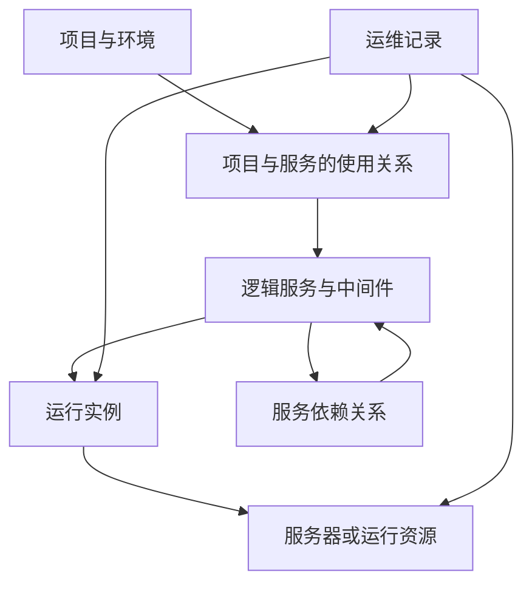

# GitHub Issue #3 来源快照

- 平台：GitHub
- 仓库：NAMEWTA/skills-hub
- 原始地址：https://github.com/NAMEWTA/skills-hub/issues/3
- 原生编号：3
- 状态：closed
- 获取时间（UTC）：2026-11-26T08:30:07.145Z
- 正文更新时间：2026-11-16T09:58:33Z
- 评论：已取回全部 0 条，与 Issue 返回计数 0 一致。

## 原始标题

feat(ops): 独立管理服务器与项目运行拓扑，部署发布由项目负责

## 原始正文

## 一、目标与最终范围

新增独立领域 **`ops`（服务器与项目运行运维）**，围绕已经运行或已有明确运行定义的服务器、服务、实例和项目关系，提供资产发现、运行观察、故障排查、计划维护、运行恢复、操作历史以及项目运维知识沉淀。

**部署发布由各项目自己的交付流程负责，已有项目继续使用 `dev-deploy`。ops 不拥有部署发布能力，不在内部调用、修改或依赖 dev-deploy，也不要求其他 domain 增加任何 ops 支持。**

本 Issue 按最新需求重新划定范围：不实现此前研究方案中的 `ops-deploy` 和通用 `ops-upgrade`；项目专属技能只生成运维能力，例如 `ops-shop-health`、`ops-shop-diagnose-dependencies`，不生成 `ops-shop-release` 一类发布技能。

提供 **`ops-workflow` 统一运维入口**，参考本仓库 [dev-workflow][R11] 按意图选择方法、沿用任务与证据、持续推进已授权工作的组织方式，在 ops 内独立实现。它协调其余八个技能，用户也可直接调用明确需要的技能；不强制所有任务经过完整流程。

需要形成两个完整视角：

1. **服务器视角：** 这台机器承载哪些实例和服务？它们参与哪些项目？资源、健康、容量和近期操作如何？维护这台机器会影响谁？
2. **项目视角：** 这个项目由哪些应用服务、中间件和外部依赖共同构成？它们运行在哪些机器或平台？服务之间如何依赖？当前异常发生在哪一段？

一个项目可以包含 web、API、worker、数据库、缓存、队列、入口代理等多个服务并跨机器运行；一台机器可以承载多个项目；一个共享服务也可以被多个项目使用。项目不强制对应单个仓库，运维不以存在源码仓库或 dev 技能为前提。

本 Issue 是可实施的详细计划。实施代码、真实运维、PR 合并和版本发布不因创建本 Issue 自动发生。

## 二、仓库基准与已有能力

- 核查日期：2026-11-16。
- 基准：[c7cd9ac034c71f346a3b89ddc4e42e648aca5379](https://github.com/NAMEWTA/skills-hub/commit/c7cd9ac034c71f346a3b89ddc4e42e648aca5379)，版本 `0.1.10`。
- 该基准实现 dev、system；尚未实现本 Issue 的 ops。
- 技能源目录：`skills/<domain>/<domain>-xxx/`。
- 安装目录：`.agents/skills/<domain>-xxx/`，没有领域中间层。
- 长期资料：所属运维工作根的 `.agents/ops/`。
- 相关入口背景：[#2 workspace 独立项目 CLI 派遣](https://github.com/NAMEWTA/skills-hub/issues/2)。本 Issue 不修改 #2，也不以实现或安装 workspace 为前提。

当前 [dev-deploy][R2] 已经拥有项目部署、升级、发布失败恢复/回滚，以及[项目与共享服务部署方法][R3]中的多主机、共享依赖和双向索引能力。新领域的价值在于建立持续运维与运行关系视角，不能描述成“现有仓库完全没有多机部署能力”，也不能接管或削减 dev-deploy。

实施前重新固定实际 main，并读取 [AGENTS.md][R1]、[安装契约][R5]与[持久化规则][R4]；后续变化仅调整 ops 的必要落点，不能扩大到其他领域改造。

## 三、职责边界：按实际效果判定，不按命令名称判定

### 3.1 运维与项目部署的分界

这里的项目部署状态包括：项目及其组成服务的制品身份、声明的运行配置、持久拓扑/规模，以及 schema。ops 可以读取和核验这些事实，但不成为它们的另一套发布入口。

| 任务 | ops 的职责 | 项目交付流程的职责 |
| --- | --- | --- |
| 服务器资源、磁盘、日志、进程、服务健康 | 检查、取证、诊断、记录 | 无需被 ops 改造 |
| 项目由哪些服务组成、服务运行在哪里 | 登记、核验、关联与展示 | 继续维护自己的项目配置与发布事实 |
| 应用构建、新部署、指定制品上线 | 提供已有现场与影响信息，形成交接 | 由项目处理；已有项目使用 dev-deploy |
| 应用或中间件镜像/二进制切版、升级 | 观察当前状态与消费者，交接发布责任方 | 确定制品、兼容性、迁移、切换与发布验证 |
| 发布后换回旧镜像、旧制品、旧部署配置 | 保存故障证据和当前状态，提供复验条件 | 发布回滚由项目负责 |
| 既有实例的同版本重启/恢复 | 核验制品、配置和启动副作用后，按授权执行并验证 | 不要求项目改技能 |
| 新增服务、改变持久副本数或项目拓扑 | 记录需求与影响，交接 | 由项目既有部署方式完成 |
| 应用 schema migration、发布配套数据转换 | 提供证据和建议，不执行迁移 | 由项目开发与部署流程处理 |
| 备份、符合当前部署兼容条件的数据恢复 | 核验数据范围、时间点、损失窗口与恢复条件，按授权运维 | 若需切版、旧 schema 或部署变更，交项目协同处理 |
| OS/内核安全维护与明确的主机重启 | 核对实际变更集合、所有已知消费者、窗口、记录与验证 | 项目组成服务的升级不能夹带其中 |
| 证书续期、日志保留等例行维护 | 限现有运行契约和明确对象，保留实际结果 | 改路由、发布配置或项目服务定义时交项目 |
| 临时摘流、恢复原流量 | 仅在已有经核实的运行方法和授权内执行 | 永久拓扑、路由或发布策略变化归项目 |

**不能只检查版本标签是否相同。** 相同 tag 对应的 digest 变化、有效配置变化、拓扑变化和 schema 变化，都可能是发布。反之，PID、容器 ID 或 Pod UID 因同版本重启而变化，不自动构成发布。

### 3.2 防止把发布能力换名放回 ops

- `ops-execute` 不接受“只要能执行命令就属于运维”的定义；SSH、Ansible、CI、Rundeck 都可能触发发布，必须检查实际作用。
- 名为 restart/repair/recover 的入口，如包含构建、拉取新制品、切换镜像、替换部署配置或 migration，应识别为跨出本领域；能分离的纯运维步骤可保留，其余形成项目交接。
- 同版本恢复必须核对实际制品与有效配置。若启动会解析浮动 tag、读取已改变的发布配置或触发未确认迁移，不能按普通重启执行。
- 不把 `apt` 等包管理器安装的 PostgreSQL、Redis、Nginx 升级自动归类为 OS 维护；检查真实包集合与服务归属，项目/共享中间件版本变更交其维护方。
- 不通过 `ops-runbook` 从历史记录生成发布技能、发布回滚步骤或应用迁移配方。
- 不在 ops 中保存竞争的发布计划、发布期望状态或 releases 历史。可以记录带时间和来源的运行版本观察、发布事件引用及其与故障的关联。

### 3.3 需要项目处理时怎样交接

ops 在自己的 run 中形成普通 Markdown 交接材料，包含：项目/环境、服务/实例、真实资源、症状、已确认事实、已尝试动作、证据、当前状态、共享影响、建议由项目处理的事项、后续运维复验条件。

由用户或上层入口进入该项目自己的开发/部署流程；该项目可按已有方式使用 dev-deploy。ops 不内置调用链，不自动安装 dev，不要求接收器、hook、标准发布回执或新字段，也不写回 `.agents/dev/`。

已有明确授权的项目任务可由上层直接接续，不因跨领域重复索要相同授权；这不改变项目方法和 ops 方法各自的归属。

若项目暂无可用发布入口或责任方，ops 完成能做的调查与记录，明确归属/能力缺口，不建立备用发布器。跨领域的后续执行遵循其独立任务与用户授权。

## 四、核心模型：服务器、实例、服务和项目的多对多关系

### 4.1 最小实体

| 实体 | 含义 | 关键内容 |
| --- | --- | --- |
| Project / ProjectEnvironment | 用户识别的系统项目及环境 | 稳定项目 ID、环境、真实文档/仓库引用、维护归属；一个项目可涉及多个仓库 |
| Service | 可独立识别的逻辑服务或中间件 | 类型、用途、维护者、健康定义、运行/部署责任引用 |
| ProjectService | 某项目环境怎样使用某服务 | 组成或依赖角色、必要性、逻辑消费范围、项目验证入口 |
| ServiceInstance | 一个服务的稳定运行单元 | 实例 ID、service ID、环境与真实运行定位、当前观测 |
| Resource | 服务器、VM、集群或托管运行资源 | 稳定身份、类型、连接引用、来源、核验时间 |
| ServiceDependency | 服务/实例之间的有向依赖 | 消费者、提供者、端点/逻辑资源范围、关系类型、证据、时间 |
| Run / TargetResult | 一次运维及逐目标事实 | 实际目标快照、动作、执行结果、现场结果、证据和记录状态 |

箭头表达关联，不直接代表权限或启动顺序。模型可以使用轻量文件和既有清单引用实现，不要求数据库、图数据库、CMDB 服务或工作流 DSL。

### 4.2 一个系统项目跨服务器组成的例子

以下全部是设计夹具，不是用户真实资产：

| 项目环境 | 使用服务 | 具体实例与位置 | 角色/消费范围 |
| --- | --- | --- | --- |
| shop/prod | shop-web | host-a 的 web unit | 页面入口 |
| shop/prod | shop-api | host-a、host-b 各一 API 实例 | 应用服务组 |
| shop/prod | shop-worker | host-c 的 worker unit | 异步处理 |
| shop/prod | pg-main | host-d 的共享 PostgreSQL 实例 | 逻辑数据库 shop |
| shop/prod | redis-main | host-b 的共享 Redis 实例 | 经项目确认的缓存/队列范围 |
| billing/prod | billing-worker | host-b 的 billing unit | 后台业务服务 |
| billing/prod | pg-main | 同一 host-d、同一 PostgreSQL 服务实例 | 逻辑数据库 billing |
| billing/prod | redis-main | 同一个共享 Redis 服务 | 经项目确认的消费范围 |

这里必须正确区分：

- **共机：** shop-api、billing-worker、redis-main 在 host-b；不代表它们彼此都有业务依赖。
- **共用服务：** pg-main 只登记一份服务及真实实例，两项目通过使用关系引用；不能复制成两个各自维护版本和恢复记录的“数据库”。
- **项目组成：** 一个完整系统有应用和中间件等多种服务；项目运维视图要展示这些关系及跨机分布。
- **服务依赖：** API 依赖数据库，不表示 worker、web、数据库之间存在全部两两关系。
- **逻辑范围：** 同一数据库实例内不同逻辑数据库/schema 的影响，不等于整个数据库实例重启的影响。

### 4.3 必须回答的查询

1. 这台服务器上有哪些运行实例、逻辑服务、已知未知对象？
2. 这些服务直接或间接服务于哪些项目环境？
3. 某项目的完整服务组成、跨机位置、依赖和异常在哪？
4. 某中间件异常时，哪些消费者和项目可能受影响？
5. 某台机器维护/重启时，哪些项目受影响、哪些仍有健康实例？
6. 某服务恢复后，除了自身就绪，还应验证哪些消费路径？
7. 某实例当前观测版本与项目文档记录有何差异？证据采于何时？
8. 该项目、服务器、服务最近执行过哪些运维？是否有未结束或结果未知的操作？

### 4.4 身份、来源与推断规则

- 稳定实例 ID 不等于 PID、临时容器 ID 或 Pod UID；短期标识保存在观测快照。
- IP、SSH alias、目录和显示名不替代真实资源身份；机器更换时保留历史可解释性。
- Kubernetes 等动态调度环境中的节点位置是观测，不永久绑定 workload 到某台节点。
- 每项重要事实保留来源、采集/核验时间与可信程度；区分声明、观测、推断和未知。
- 网络连接、相同名字或同机关系只能提供线索，不能自动推出项目归属或完整依赖图。
- 项目成员关系来自明确资料或核实，不把一张连通的依赖图自动合并成一个项目。
- 发现无归属进程/容器时保留未知，不自动接管、停止或删除。
- 区分业务依赖、共享资源、运行先决条件。启动/恢复顺序使用已有经验证的运行方法，不从所有依赖边机械生成操作顺序；循环和缺口显式说明。
- 复用已有 Ansible inventory、云资源清单、项目配置和运行手册。ops 保存引用及必要观测，不维护第二份竞争的 IP 或部署配置真相。

## 五、九个 ops 技能及方法归属

完整领域由一个编排入口 `ops-workflow` 和八个专门技能组成，移除发布技能与通用升级技能。用户通过自然语言进入相应能力，不需要记住全部技能名；明确的单项任务可直接进入对应技能。

| Skill | 拥有的方法 | 主要产物 | 明确边界 |
| --- | --- | --- | --- |
| `ops-workflow` | 意图识别、按需路由、任务拆分、上下文传递与任务级汇总 | 目标与完成条件、所选方法、进展和未完成事项 | 不重写专门方法、不另建执行/记录引擎、不强制全链 |
| `ops-inventory` | 资源身份、服务实例、项目使用关系、依赖与影响查询 | 运行拓扑、事实来源、缺口 | 不创建部署、不自动接管发现对象 |
| `ops-execute` | 一次运维的目标复核、工具调用、记录、中断核实 | run、步骤、逐目标结果 | 不做隐藏发布器或万能命令平台 |
| `ops-inspect` | 明确目标与时间范围的只读运行采集 | 健康、容量、版本、证书、备份与漂移报告 | 不自动修复或升级 |
| `ops-diagnose` | 症状、假设、证据、变更关联、根因与有限缓解 | 调查结论、原路径复验、项目交接 | 不以排查名义发布、迁移或做未授权实验 |
| `ops-maintain` | 明确对象的计划性服务器与现有服务维护 | 维护计划、影响、实际结果 | 不夹带项目/中间件发布和版本切换 |
| `ops-recover` | 既有部署下的运行恢复与兼容的数据恢复 | 恢复状态、数据影响、消费者验证 | 不负责制品回退、部署配置回退或应用迁移 |
| `ops-history` | 同一批运维事实的多维查询和交接 | 时间线、关联证据、未完成事项 | 不复制发布历史、不改外部工单状态 |
| `ops-runbook` | 运维证据筛选、项目手册/专用技能生成和维护 | 项目运维技能、验证范围、失效条件 | 不生成发布技能、不修改其他领域 |

### 5.1 `ops-workflow`

**定位与触发：** 当用户希望统一处理服务器或项目运维、一个目标涉及多项运维能力、下一步尚不明确，或需要在处理过程中协调进展时，作为默认可选入口。它与 [dev-workflow][R11] 一样拥有协调方法，具体运维判断和操作仍由各专门技能拥有；不存在对 dev-workflow 的运行依赖。

**入口要明确的内容：** 用户目标与可观察的完成条件、实际运维工作根、已有项目/环境/服务器线索、授权与限制、已有 run/证据、当前阶段及所需返回结果。先利用已知信息完成可做部分；只有会影响目标、权限或操作正确性的实质缺口才要求补充，不为简单查询填写整套模板。

#### 按意图选择下一步

| 用户当前意图 | 选择的方法 | 需要保留的边界 |
| --- | --- | --- |
| “这台机器有哪些服务，分别属于哪些项目” | `ops-inventory` 核验身份、组成与使用关系 | 不因发现对象而接管或操作 |
| “检查 shop/prod 是否健康” | `ops-inspect`；仅在目标或关系不足时补 inventory | 检查不自动升级为修复 |
| “项目异常，帮我定位并处理” | `ops-diagnose`，按需查询 history；已授权且符合边界时交 recover/maintain | 依据证据推进，不凭症状直接重启 |
| “维护 host-b” | `ops-maintain`，按需取得 inventory 的影响范围 | 实际包集合、共享影响和维护窗口由专门方法判断 |
| “恢复这个已经存在的服务” | `ops-recover` | 先核验现有部署与真实副作用，不变成重新发布 |
| “昨天这台机器/这个项目做过什么” | `ops-history` | 直接查询所需历史，不强制现场巡检 |
| “继续刚才中断的任务” | 用 history 找到已有事实，由 `ops-execute` 核实原任务和现场，再回到原任务 owner | 沿用原 run；不重放已经发生或仍未知的动作 |
| “把稳定的项目运维经验整理成技能” | `ops-runbook` | 可直接使用已有证据，不为生成技能重走维护或恢复 |
| “升级 Redis / 发布新版本 / 回到昨天镜像 / 执行 migration” | 在 ops 记录中形成项目交接 | 由项目自己的流程处理，ops 不调用 dev-deploy |
| 处理中询问进展或明确暂停 | 按当前 run 汇总；暂停按 execute 的真实中断能力处理 | 询问进展不取消原目标，暂停不等于远端已停止 |

这些是路由规则，不是固定顺序。已有目标和方法明确时直接推进；只要求查询、解释或计划时，交付对应结果，不自动进行维护、恢复或知识沉淀。同一目标的后续指令与已有授权一起解释，范围没有实质变化时不重复审批。

#### 协调与方法归属

1. **按需编排。** 先明确结果，再选择最少且足够的技能。只加载当前分支需要的方法与项目资料，不递归加载全部技能、全部项目和所有历史。复合任务可拆成可验证步骤；先后关系来自任务 owner 已核验的前提，不能仅凭依赖图推导重启或恢复顺序。
2. **一项任务、一份主记录。** 由 `ops-execute` 创建或接续主 run，入口及内部技能调用成为其中的步骤；执行、记录、中断核实和重试方法仍归 execute。继续同一任务沿用原 run；明确的新任务建立新 run，并按需要关联旧任务，不让所有未来操作共用一个永久 run。
3. **传递实际上下文。** 交给专门技能的材料包含已核验目标、现有证据/决定、授权边界、run/子 run、期望产物和返回条件。inventory 拥有目标关系，history 拥有历史查询，runbook 拥有知识筛选与生成；workflow 不维护第二套清单、日志或项目手册。
4. **共享对象协调。** 独立取证可以并行；共享服务的变更由唯一执行者负责，遵守第九节的实际资源冲突规则。汇总逐目标结果和覆盖缺口，不因两个项目都需要 Redis 恢复而重复执行。
5. **接续到可核验结果。** 按证据决定继续当前方法、转入其他 ops 方法、形成项目交接或报告缺口。区分临时缓解、服务恢复、根因确认、部分失败与结果未知；专门技能返回后对照最初完成条件，不把写出计划或命令退出当成问题已解决。
6. **入口可选、领域独立。** 原有八个技能可直接使用，不要求先经过 workflow。部分安装缺少必要 owner 时明确能力缺口，完成可做的分析和计划，不复制临时方法、创建无记录执行路径或静默补装其他 domain。需要独立项目 CLI 时沿用第九节的用户选择与真实上下文核验，不新增调度平台或 workspace 依赖。

**资源建议：** 本包只维护意图与路由方法、任务拆分与上下文交接、进展与结果汇总，以及相应示例/反例；通过本包的 `references/method-index.md` 按需导航。执行记录契约、目标解析、诊断/维护/恢复步骤和项目技能生成方法留在各 owner，不递归复制资源，不新增流程 JSON、强制状态机或独立持久化根。

### 5.2 `ops-inventory`

输入为用户明确的运维工作根、服务器/项目线索、已有清单和授权范围。

流程：读取权威来源→在授权范围采集实际运行对象→识别实例和逻辑服务→核验项目使用关系与依赖→建立双向查询→标记差异、过期与未知。

不得默认扫描所有账号/网段，不把“登记成功”当成取得变更权限。首次初始化先通过 ops-execute 建立无远端目标的本地 run，再逐步补充已核验目标，避免记账与清单的循环依赖。

资源建议：资产与服务模型、目标解析、关系证据方法、项目/服务/服务器模板。资料按需创建，不预生成虚构项目。

### 5.3 `ops-execute`

唯一持有通用执行与记录方法。调用方传入本次目标、动作、实际入口、已有授权、验证与停止条件，沿用同一 run。

流程：建/续 run→复核对象身份与领域边界→检查记录和冲突条件→调用已确认的既有工具→逐步保留事实→核验现场→形成结果。

必须检查入口的真实效果。执行能力不扩大本领域范围，也不让一次用户授权绕过其实际目标/影响限制。已明确授权的同范围步骤持续完成；只在实质缺口、范围扩大或底层平台要求时停下。

中断后先查询已有 job/session 与现场，再决定重试；不承诺跨机事务、exactly-once 或不存在的锁能力。不创建新权限系统、常驻调度服务或 Agent runtime。

资源建议：执行记录契约、中断与重试、后端能力、结果模板；少量确定性 `.mjs` 辅助归本包，其他技能不复制另一套记录脚本。

### 5.4 `ops-inspect`

按明确的资源、实例、项目和时间窗口，只读检查系统资源、磁盘/inode、服务状态、错误、依赖连接、版本、证书及备份新鲜度等。基线/SLO/阈值来自实际项目或用户约定；缺失时报告观测和判断缺口，不编造统一阈值。

区分“正常”“未发现异常”“数据缺失”“检查失败”“覆盖不完整”，每条关键结论回链证据。项目视图汇总自身服务和共享依赖，不只看一个 HTTP 端口。

### 5.5 `ops-diagnose`

先定义症状、影响和开始时间，优先读取已有证据；关联近期主机维护、项目发布、配置和共享依赖变化。发布只作为关联事件，不成为 ops 自己执行发布的理由。

使用可证伪假设，保存支持/反对证据、已排除项和未知。多项目同时间异常时核查共机资源与共同依赖，不能直接认定共同根因。

获准缓解沿运维边界执行，重新验证原失败路径。需要应用修复/重新发布时形成项目交接；重大事件按实际条件复盘，不要求普通查询写完整事故报告。

### 5.6 `ops-maintain`

覆盖已明确范围的服务器 OS/内核维护、主机重启、证书续期、日志保留、备份、容量处置及既有服务的例行运行维护。

先核对实际对象与影响，包括同机无关服务、共享中间件、维护窗口、冗余与冲突任务。OS 维护审查实际包集合和重启影响，不能无条件全量升级。

证书续期限定原身份与既有配置契约；改变路由、服务定义或发布配置时转项目。容量清理必须识别具体日志/缓存/卷/备份及归属，“磁盘满”不授权全主机 prune 或删除数据库卷。

定时任务仅在用户明确要求或既有计划授权时配置，不因存在此技能就创建无人值守运维。

### 5.7 `ops-recover`

覆盖已有运行单元的启动/停止/同版本重启、按已验证方法的同版本恢复、既有流量切换，以及满足当前部署兼容条件的数据恢复。

如果一个系统项目需要多个既有服务协同启动，按项目已验证的运行先决条件和就绪规则操作，保留逐服务结果。不得借“启动完整项目”构建/下载新制品、新增持久资源、扩容、改项目配置或执行 migration。

恢复前核对当前制品身份、有效配置、资源定位、数据/schema 条件和启动副作用。既有实例的恢复性重建只有在身份、制品、配置、挂载与范围可核验且已有配方支持时才属于运维；不能默认为任意 Compose up 都是恢复。

数据恢复说明恢复点、可能丢失的新写入、兼容性和验证。若需要旧 schema、切换数据库/应用版本或发布配套转换，停止将其作为独立 ops 恢复，形成项目协同事项。

共享服务只执行一次恢复，验证相关消费者。临时缓解、服务恢复、根因确认分别报告。项目制品回滚仍归项目。

### 5.8 `ops-history`

支持按项目、环境、服务器、逻辑服务、实例、共享资源、时间和动作查询同一批记录。

展示实际操作、验证、恢复、项目交接与未知任务，不把计划当事实。索引失效可重建，不由缺少索引记录推断“没有发生”。当前运行摘要带来源和时间，不覆盖旧 run。

历史查询本身留轻量调用记录，以查询开始时的时间截点检索，避免本次记录递归改变查询结果。

### 5.9 `ops-runbook`

学习现有 [dev-personalize][R6] 的证据筛选，以及 [dev-verify 的项目技能生成与维护方法][R7]，在 ops 内形成独立实现，不调用或修改这些技能。

先识别已有资料，原地维护仅限 ops 自有资料及本次用户指定的项目运维文档/ops 技能；其他领域只读取引用。

从真实运行记录提炼：现象、范围、版本、前提、证据、已验证处理、失败尝试、反例和未确认项。可变地址、版本与实例关系留在事实来源；稳定判断与操作方法进入项目专属技能。

输出示例：`ops-shop-health`、`ops-shop-diagnose-dependencies`、`ops-shop-recover-workers`。恢复技能仍受本 Issue 的部署边界限制，不能暗含镜像回退、配置发布或 migration。

每份项目技能写明适用条件、真实入口、停止条件、验证范围、来源 runs、维护者和需要重新核验的变化。从未实测的危险路径标草稿/未验证；不为验证技能而自动在生产重启或恢复数据。

## 六、典型用户旅程与产物

以下请求均可从 `ops-workflow` 进入，也可直接使用对应专门技能。workflow 负责选择方法、传递已有上下文和汇总结果；需要执行/记录时共同使用 `ops-execute` 的方法，不为每个内部调用重开主 run。

### 6.1 “看看 host-b 上有哪些服务，它们属于哪些项目”

建立 run→核对 host-b 身份→只读采集已授权运行对象→定位实例/服务→与项目资料关联→展示已核验归属、共享关系与未知对象。

产物包括服务器服务清单、项目反向视图、依赖来源和采集时间；不会启动、停止或接管任何服务。

### 6.2 “shop 整体为什么不正常”

读取 shop/prod 的组成服务、共享依赖与跨机位置→检查各层状态→关联发布/主机维护时间线→收集支持和反证→识别异常路径与可能共同依赖→按允许范围缓解或交接。

产物分别说明项目可用性、异常服务、影响链、已确认原因和仍未知项；不能只因 API 端口通就宣布完整项目正常。

### 6.3 “今晚维护 host-b，需要影响哪些项目”

列出 host-b 的全部已知实例→反查直接项目和共享服务消费者→标明未知资产覆盖→确认实际维护包集合/动作与窗口→按现有协调方式执行→逐服务/消费者验证。

项目服务升级如混在 OS 更新计划中，应从本次维护分离并交其发布责任方。

### 6.4 “共享 Redis 掉了，恢复当前服务”

核实同一个共享服务身份及所有已知消费者→确认当前制品、配置和数据状态→根据既有恢复配方只执行一次恢复→验证服务和消费者→保留各目标结果。

若根因要求升级 Redis 或修改项目发布配置，形成项目交接，不让两个项目 Agent 分别升级同一实例。

### 6.5 “这个项目已经运维稳定，形成项目技能”

读取授权范围内的历史、现行手册与真实工具入口→提炼有限、可重复的方法→用回放/测试环境/已有授权实操验证→生成项目专属运维 Skill→按新证据增量维护。

不把偶然恢复当确定根因，也不把一次事件被多份摘要引用当成多次独立验证。

## 七、每次调用的运维记录

### 7.1 一次事实，多种查询

一次独立运维任务通过 `ops-execute` 建立主 `run_id`，从 `ops-workflow` 进入或直接调用专门技能均遵循相同契约。入口路由、内部技能调用与实际操作留下相应步骤，内部技能共享同一记录；独立执行会话可以用子 run 关联父 run。重试有独立 attempt，保留前一次事实。

同一任务的进展询问、补充信息和中断接续沿用原 run，不按聊天轮次或技能调用次数新建主记录。明确的新目标另建 run，并按需要关联旧记录。workflow 的任务级摘要回到同一 run，由既有单一写入者按 execute 契约维护，不新增一份竞争流水。

同一 run 的汇总记录由单一写入者维护；并行会话保存各自的子 run 或独立步骤结果，通过唯一 ID 关联，再由父任务汇总。文件记录使用原子写入，避免覆盖或丢失其他会话的事实；查询索引是可重建的派生数据。

项目历史、服务器历史、服务历史都是同一记录集的视图，不维护多个彼此竞争的流水。普通只读查询、无变化、失败、被阻止、取消、交接和结果未知的调用也留下适量记录，不为每次小查询创建大量空模板。

### 7.2 最低信息

| 类别 | 必须能够回答 |
| --- | --- |
| 请求 | 谁/哪个会话因为什么目标发起，何时开始结束 |
| 目标 | 实际服务器、服务、实例、环境；直接对象与可能受影响项目分别列出 |
| 快照 | 当时的身份、运行定位、观察版本、相关关系来源与核验时间 |
| 方法 | 技能/runbook/脚本版本，实际执行工作目录与连接身份引用 |
| 授权 | 当前请求或既有明确策略的范围与限制，不记录秘密值 |
| 过程 | 计划、实际动作、步骤顺序、后端任务 ID、已确认进展 |
| 结果 | 执行状态、现场结果、记录状态三个维度；逐目标差异 |
| 验证 | 原失败路径、健康和相关消费者的结果、证据及未覆盖项 |
| 后续 | 恢复结果、项目交接、剩余未知、经验候选 |

记录先于第一项现场操作建立，执行中保留关键步骤。对现有 Rundeck/CI/作业平台，关联其权威 execution 和必要摘要；ops 不触发发布型 job。原始大日志优先留在已有受控平台，保存查询条件、时间和脱敏摘录。

### 7.3 失败与中断

- a 成功、b 失败、c 未开始时，逐目标保留；不能报全体成功。
- 远端接受操作后断线，结果为未知/待核实；先查现有任务和现场，不认为没执行而直接重试。
- 命令失败前可能已经改变现场，执行状态与现场状态分开。
- 记录位置不可写且没有可用后端记录时，不先修改现场再承诺补账。
- 执行中摘要保存失败，保留后端任务引用并核实；不因为记账失败重放有副作用动作。
- 本地摘要失败但后端仍完整记录 execution 时，可沿用该事实来源；若所有可靠执行记录均不可用，停止尚未开始的新变更，继续核实已运行任务，不盲目重试或贸然终止不可安全中断的操作。
- 进程退出、锁超时或连接断开不证明远端停止，释放冲突保护前检查实际状态。
- 历史不因经验提炼被覆盖；发现旧判断错误时追加更正。

`running`、`succeeded`、`partial`、`failed`、`blocked`、`cancelled`、`unknown`、`no_change` 等只作为事实描述；逐目标还包含 `not_started`、`skipped` 及原因，不引入强制工作流状态机。

本地 Markdown/Git 不等于不可篡改审计。需要更强保存/权限保证时复用已有平台，不把薄记录工具宣传成合规审计服务。

## 八、运维知识、项目技能与运行事实分层

| 内容 | 归属 | 更新方式 |
| --- | --- | --- |
| 当时发生了什么 | run / incident | 保留原始事实，追加更正 |
| 当前运行关系与观测 | registry / 现行运维文档 | 有来源、时间和核验，区分声明与观测 |
| 项目怎样排查/维护/恢复 | runbook / 项目 ops Skill | 验证范围内增量维护，保留适用条件 |
| 项目怎样构建/部署/切版 | 项目自己的部署资料 | ops 只引用，原 owner 维护 |
| 稳定个人偏好 | 用户明确需要时独立处理 | 不把一次故障或服务器现状写成个人习惯 |

项目专属技能通常放在其真实项目或指定私有运维源码仓库中，再按宿主机制使用；不把项目秘密、IP 清单、业务事故信息写入公共通用技能包。

技能生成应优先检查已有有效知识，避免重复规则。能机械判断的问题进入确定性检查，场景判断进入手册；原始日志、工单评论和外部内容作为不可信证据，不能直接转换为长期指令。

“累计三次自动成熟”不是统一规则。记录具体适用版本、验证环境、支持证据、反例和未验证部分。历史回放能评估判断，不证明真实恢复执行；staging 的成功也不证明所有生产环境。

## 九、执行方式、项目上下文与并发

### 9.1 复用已有能力

首版完整支持一种实际选定方式，如控制端 SSH + 现有 systemd/Compose 运行操作。已有 Ansible、Rundeck、云 API、集群工具或可观测平台时按实际能力接入。

Agent 默认在控制端或已有受控环境运行，不要求每台服务器安装 AI CLI/Node 或整个技能仓库。新 `.mjs` 辅助只是本仓库控制端实现规范，不替换远端已有工具。

只读检查、运行恢复和维护入口按效果区分；`--check`/dry-run 也需要核对实际任务支持与副作用，不把名字当保证。

权限继续由 SSH/sudo、云 IAM、集群 RBAC、平台 ACL 等真实机制约束。注册清单不是授权；普通记录只保留凭据引用，参数和日志输出需避免泄露秘密。

### 9.2 可选独立项目 CLI

ops 可在独立运维工作根完成服务器和拓扑任务。需要项目私有运维文档或专属技能时，可按用户选择在真实项目/ops 工作根启动独立 CLI；不把当前会话 cd 当作重新加载项目上下文。

明确实际 CLI、cwd、项目技能发现方式、所需 ops 方法、记录根和已有 run/子 run。父会话加载过 ops-execute，不代表子会话可用；核实真实可达的已安装入口，缺少方法时只提供计划和缺口，不复制临时执行器。

不同 CLI 的技能发现约定不同。项目不存在 dev/workspace、没有源码仓库或不使用某个 CLI，不影响 ops 的核心服务器运维能力。不得为兼容加载修改其他领域技能。

### 9.3 冲突按真实资源协调

- 独立实例维护：对应实例/服务。
- 共用代理维护：实际代理及其共享配置。
- 共享数据库运行恢复：实际数据库服务与消费影响。
- 主机维护/重启：整台主机和所有已知运行对象。

复用现有后端并发控制和锁能力；单机锁不能宣称跨控制端互斥。并行 Agent 可以独立取证，共享服务变更需要唯一执行者。影响分析用于展示范围，不自动扩大写权限。

## 十、持久化与领域独立性

### 10.1 新增资料位置

| 内容 | 位置 |
| --- | --- |
| 技能源码 | `skills/ops/ops-<name>/` |
| 安装资源 | `.agents/skills/ops-<name>/` |
| 最小导航 | `.agents/ops/AGENTS.md` |
| 运行关系与来源 | `.agents/ops/registry/` |
| 项目运维知识 | `.agents/ops/projects/<project-id>/` 或明确已有权威位置 |
| 操作事实 | `.agents/ops/runs/<run-id>/` |
| 跨 run 事件 | `.agents/ops/incidents/<incident-id>/` |
| 经验候选 | `.agents/ops/lessons/` |
| 可重建查询索引 | `.agents/ops/index/` |

只有导航由安装器初始化，业务目录按需创建。自定义运维规则不写入安装器会覆盖的导航模板。

### 10.2 其他 domain 零改动

- 不修改 `skills/dev/**`、`skills/system/**` 或任何其他领域的技能、参考、模板和脚本。
- 不在其他领域增加 ops 支持技能、字段、接收器、hook、回执格式或初始化步骤。
- 不改变 dev-deploy 的触发条件、方法、持久化、上游采用关系和发布能力。
- 不修改其他领域的持久化模板、专属方法归属、安装默认行为或校验语义。
- 不向 `.agents/dev/`、`.agents/system/`、`.agents/workspace/` 写运维记录，不自动同步/迁移/归档它们的内容。
- 现有项目配置、部署记录和其他领域文档可按真实路径读取引用，不能成为必须安装的依赖。
- 若引用资料和现场不符，在 ops 中记录差异；不复制完整发布手册作为第二份现行规则，也不强制原 owner 为 ops 更新格式。
- 新增 ops 的来源映射不能顺便刷新旧领域快照、runtime_paths 或 runtime_reviewed_blob。

同一领域内可以按技能名协作。资源自洽要求本包拥有的完整方法/模板/脚本在包内，不代表每个技能重复所有方法。禁止 `../兄弟技能/` 资源链接；无宿主 Skill API 时读取真实可用入口，不伪造调用。

完整 ops 独立可用；当前安装器不自动解决域内依赖。部分安装缺少所需 owner 时完成材料分析和计划，明确执行/记录缺口，不静默补装其他 domain，也不绕过记录执行。

## 十一、仓库实施落点与工程约束

### 11.1 最小改动清单

| 位置 | 本 Issue 的改动 |
| --- | --- |
| `skills/ops/ops-{workflow,inventory,execute,inspect,diagnose,maintain,recover,history,runbook}/` | 新增九个完整技能包，一个编排入口与八个专门 owner |
| `scripts/persistence/ops.md` | 新增短导航模板 |
| `scripts/init-persistence.mjs` | 追加 ops 初始化目标，保留旧目标语义 |
| `cli.mjs` | 增补 ops 初始化提示，原领域选择不变 |
| `install.mjs` | 必要帮助文字增量；沿用已有自动扫描/复制/备份机制 |
| ops 范围检查及安装/持久化测试 | 新增目标、记录、边界与隔离案例，不放宽既有规则 |
| `docs/ops.md`、`docs/ops-method-ownership.md` | 新增完整使用说明、九技能方法归属、入口路由、发布边界与示例 |
| README、通用安装/持久化说明 | 仅追加 ops 接入，不重写其他领域职责 |
| 本次采用材料、许可和必要变更说明 | 只记录 ops 实际采用与核对结果 |

现有安装器已经按 `skills/<domain>/<domain>-xxx/SKILL.md` 自动发现，不新增人工 catalog、依赖注册服务或流程 JSON。npm 白名单已覆盖 skills 和 persistence 模板；实际交付仍核对打包结果。[R5][R8]

### 11.2 包装与代码约束

- 执行内容中文；frontmatter 仅 name、description。
- 名称使用 ops 前缀、小写连字符且不超过 64 字符。
- SKILL 主体不超过 500 物理行和 12000 非空白 Unicode 字符，完整方法按需放本包资源。
- 新增维护/运行/测试脚本使用 `.mjs/.js`、Node.js 22.14+；不新引入 Python、Shell、TypeScript 运行依赖，既有外部运维工具照常使用。
- 不增加固定模型、强制流程状态机、重复审批、常驻 Agent 引擎或 Web 控制台。
- 所选方法保留完整步骤和判断标准；不把研究摘要当已适配的运行技能。
- 运行包不放作者署名/来源 URL；来源、原件/译文、采用映射与许可按仓库既有规范集中处理。
- 真实运维记录和项目定制不写入通用已安装技能包；项目 Skill 用不冲突的名称和独立源码位置。

## 十二、成熟方法采用计划

优先复刻已经核查的成熟方法单元，必要适配围绕本 Issue 的运维范围、中文资源、Node 约束及实际后端能力。完整保留所选方法的判断和例外；涉及去除发布职责的适配在采用说明中标明原段、原因和保留内容。

| 来源 | 本 Issue 的采用方向 | 不纳入的能力 |
| --- | --- | --- |
| Anthropic oncall-kit | 能力映射、事件调查、经验候选、手册维护、回放验证 | 不复制其完整托管/沟通环境，不把示例当真实生产接入 |
| OpenAI Sentry Skill | 只读观测、输出字段和证据边界 | 不推导出通用部署能力 |
| Azure Diagnostics | 症状、资源健康、日志/指标与证据区分 | 不引入 Azure Deploy / Upgrade 工作流 |
| Docker Skills | Compose 实例定位、健康、卷/共享对象的影响范围 | 不迁入构建、制品发布或项目配置生成流程 |
| Google SRE | 过程记录、事件恢复/根因区分、有效复盘 | 不将发布方法变成 ops 技能 |
| Ansible / Rundeck | 既有资源来源、运行目标、执行记录与后端能力 | 不要求安装新平台，不调用发布型任务 |
| Kiro 第一方实践 | 任务上下文、记录、经验校验、项目手册演进 | 不把未公开内部技能当现成开源包 |
| Matt retro | 将经验落到可发现知识与确定性检查 | 不接管项目开发/交付流程 |
| 本仓库 [dev-workflow][R11] | 按意图选择最小入口、沿用现有任务/证据、按需加载、协调推进与结果收束 | 不调用、不修改、不复制开发/部署阶段，不成为 ops 运行依赖 |
| 本仓库 dev-personalize / dev-verify | 证据筛选、项目特化方法生成与维护的已有思想 | 不调用、不修改、不要求项目安装 dev |

已核查的上游快照：

- Anthropic oncall-kit：`c03282cd5381a5a2e12e32bfb3c8957d52ce01f1`，Apache-2.0；README 明确为不持续维护的参考实现。[S1]
- OpenAI skills：`49f948faa9258a0c61caceaf225e179651397431`，所读 Sentry 包 Apache-2.0。[S2]
- Microsoft azure-skills：`968f7bfaa01672e782dae2c6bab4fb9505ae047a`，MIT。[S3]
- Docker skills：`a65ae5b65d22f0613375d6c3e5ea8bb287698cc0`，Apache-2.0。[S4]

实施若跟踪新版本，先重新解析再固定同一提交核对，记录真实采用范围。概念参考与代码/方法实际采用分开；不整库引入所有研究来源，也不前移其他领域旧的核验依据。

## 十三、实施顺序与交付物

### 阶段 A：边界、模型与独立接入

- [x] 固定实现基准和允许改动清单，保留其他领域文件/安装行为基线。
- [x] 完成 ops 说明与方法归属，明确无发布能力、无通用升级技能。
- [x] 实现 inventory 与最小 execute 记账能力，支持无远端目标初始化。
- [x] 实现 workflow 的意图路由、上下文传递与任务级汇总，使用同一 run；后续阶段接入其对应 owner，不复制尚缺方法。
- [x] 明确入口依赖和直接调用契约；不强制所有任务经 workflow，不因安装入口而执行全部分支。
- [x] 用项目—服务、服务—实例、实例—资源和依赖关系表达多对多。
- [x] 按加法接入安装与持久化，不改变其他 domain。

### 阶段 B：双向运行视图、检查与历史

- [x] 完成 inspect/history，能从机器反查项目，从项目查看完整服务组成。
- [x] 保存采集时间、来源、未知归属、声明与观测差异。
- [x] 使用一种现有后端完成真实只读实例识别与记录验证。
- [x] 证明缺少 dev/system/workspace 时仍能工作。

### 阶段 C：诊断、维护与运行恢复

- [x] 完成 diagnose/maintain/recover，按动作效果验证领域边界。
- [x] 对共机和共享服务按实际资源协调，保留逐目标结果。
- [x] 验证同版本恢复、部分失败、断线未知、记录失败、重试副作用。
- [x] 验证发现需要发布时只交付项目交接，没有隐藏发布执行。

### 阶段 D：项目知识沉淀

- [x] 完成 runbook，生成至少一份范围有限的项目运维技能。
- [x] 使用现有证据、回放、测试环境或授权操作验证其声明范围。
- [x] 验证新会话可取得实际项目技能、所需 ops 方法与记录位置。
- [x] 验证过期知识、错误根因和包含发布步骤的候选不会被当有效运维技能启用。

### 阶段 E：验收与打包

- [x] 同步新领域说明、方法、实际采用映射、许可与打包结果。
- [x] 确认其他领域源码、资源、模板、旧映射和校验语义保持不变。
- [x] 验证 workflow 的轻量查询、复合任务、中断接续、共享对象、项目交接和缺少 owner 情形，与直接调用专门技能保持一致的执行/记录边界。
- [x] 运行必要检查，分别报告静态、模拟和实际后端验证。
- [x] 给出已支持能力、真实版本/环境、未验证范围和剩余事项。

## 十四、验收矩阵

| # | 场景 | 通过条件 |
| --- | --- | --- |
| 1 | 单独安装完整 ops | 不安装或运行依赖 dev/system/workspace，可识别与运维已有服务 |
| 2 | 安装/升级 ops | 其他领域文件与行为不变；只新增所选 ops 技能和导航 |
| 3 | 只安装其他领域 | 不新增 ops 目录、技能或初始化副作用 |
| 4 | 一个项目多个服务跨多机 | 能展示完整组成、实例、位置与依赖，不能简化成单服务单机器 |
| 5 | 多项目共机 | 从机器反查全部已知服务/项目，维护一个 unit 不重启无关对象 |
| 6 | 两项目共用同一中间件 | 一份服务身份，多项目引用；操作和历史不复制成多份 |
| 7 | 同机、同名或一次连接 | 不自动认定项目归属/业务依赖；推断有来源且可标未知 |
| 8 | 未识别服务 | 保留未知与覆盖缺口，不擅自停止、清理或接管 |
| 9 | 实例重启产生新 PID/容器 ID | 稳定运行单元可追踪，新短期身份保留为观测，不丢历史 |
| 10 | 只说“处理 shop”但环境有歧义 | 完成可做的解析，明确缺失目标，不猜生产执行 |
| 11 | 要求 ops 发布新镜像 | 形成项目交接；无构建、拉取新制品、切版或发布型 job 调用 |
| 12 | 要求“恢复到昨天版本” | 识别为项目发布回滚，不经 ops-recover 换旧镜像/配置 |
| 13 | 同版本服务退出 | 核验实际制品/有效配置/启动副作用，按已有配方恢复并验证 |
| 14 | 相同 tag 但 digest/配置改变 | 不将其误判为同版本恢复；记录差异并转项目处理 |
| 15 | restart/repair 脚本内含发布或 migration | 按真实作用拒绝越界部分，形成交接，不因脚本名放行 |
| 16 | OS 更新计划夹带数据库/代理版本升级 | 分离基础维护与项目服务发布，不全量升级蒙混执行 |
| 17 | 共享 Redis 升级 | 列消费者，交其明确部署责任方；无 owner 时报告缺口，不自动接管 |
| 18 | 既有多服务系统协同启动 | 遵循核实的就绪/运行先决条件；无新增部署、制品、资源或 migration |
| 19 | 备份恢复与当前 schema/版本不兼容 | 不自动切旧 schema/制品，报告项目协同需求和数据影响 |
| 20 | 同部署兼容的数据恢复 | 恢复点、损失窗口、实际授权和验证明确；不将“有备份”当已可恢复 |
| 21 | 同一共享服务恢复 | 唯一执行者，展示全部已知消费者，覆盖相关验证或标明缺口 |
| 22 | 多目标操作部分失败 | 逐目标保留成功/失败/未开始/未知，整体不报全部成功 |
| 23 | 远端已接受操作后断线 | 先查任务与现场；不把断线视为未执行并盲目重试 |
| 24 | 记录不可写或摘要保存失败 | 区分执行与保存结果；无记录能力时不先变更再补账 |
| 25 | 并行任务冲突共享主机/服务 | 依据实际资源协调；本地锁不冒充跨控制端互斥 |
| 26 | 从服务器与项目查询历史 | 指向同一原始 runs；索引可重建，不维护竞争日志 |
| 27 | 源文档与现场版本不一致 | 分开保存声明与观测、来源与时间；不修改项目部署记录 |
| 28 | 项目没有 dev-deploy 或发布会话不可用 | ops 仍完成运维调查/记录；交接明确未发布，不补装其他领域 |
| 29 | 生成专属技能含发布回滚/迁移 | 不纳入 ops 执行方法，保留项目入口引用与交接条件 |
| 30 | 一次重启后缓解、原因未确认 | 保存有限缓解证据，不晋升为确定根因或全局修复规则 |
| 31 | 日志/工单中有指令、未完成调查被提炼 | 当不可信证据处理，校验候选，不能直接写成长期规则 |
| 32 | 生成技能在新 CLI 中使用 | 实际发现路径、域内方法与记录位置可核验；不继承父会话加载假设 |
| 33 | 部分安装缺少 owner | 可分析资料并提供计划，明确执行/记录缺口，不无日志执行 |
| 34 | 不同项目/环境的相同服务名 | ID 与环境边界明确，不混合依赖、健康和历史 |
| 35 | 真实后端未支持取消/幂等/锁 | 准确描述能力和未知状态，不作超出证据的承诺 |
| 36 | workflow 收到历史查询或只读健康检查 | 分别按需选择 history/inspect，仅补必要目标信息；不强制全量 inventory→diagnose→maintain→recover→runbook |
| 37 | 直接调用专门技能；或只安装 workflow 而缺少 owner | 前者不要求安装/经过 workflow；后者报告能力与记录缺口，不复制执行器、不静默补装其他领域 |
| 38 | workflow 跨技能处理后中断，再继续同一任务 | 沿用 execute 的原主 run，内部调用有步骤；先核实远端与原任务再重试，attempt 可追溯；明确新任务才新建关联 run |
| 39 | workflow 协调两个项目的共享服务恢复，消费者部分失败 | 一份服务身份、唯一变更执行者，保留逐目标结果和验证缺口，不重复恢复或报告全体成功 |
| 40 | 只要求用已有证据生成项目运维技能 | 直接路由 runbook，不重新巡检/重启来凑流程；临时缓解与未验证内容不自动晋升为有效规则 |
| 41 | 从 workflow 提出升级、制品回滚或 migration | 形成普通项目交接，不调用 dev-deploy 或绕到 execute 发布；其他领域无新增支持要求 |

验证保持克制：复用现有检查和安装测试；用少量临时目录、受控清单和假后端覆盖边界/失败语义，再对选定环境进行已授权的真实只读与维护验证。不得为认证技能在生产注入故障、升级中间件或恢复数据库。

修改安装/验证行为时按仓库要求运行 `node scripts/check.mjs --full`，并核对实际 npm 包；仅靠 mock 或入口结构检查不能宣称真实运维链路通过。[R1]

## 十五、完成定义

- [x] 九个 ops 技能方法清晰、资源自洽，完整领域独立可用。
- [x] ops-workflow 可按意图协调其余八个技能，原有方法归属与直接调用能力保留；无需固定全链或第二套记录。
- [x] 入口能传递已有目标、证据、授权和 run，处理进展询问及中断接续，并据实汇总部分失败、未知与项目交接。
- [x] 服务器、实例、服务、项目环境、使用关系与依赖模型可以真实表达多对多。
- [x] 同时支持服务器视角、项目视角和共享服务消费者视角。
- [x] 没有 ops-deploy、通用 ops-upgrade 或换名隐藏的发布执行能力。
- [x] 应用/中间件切版、发布回滚、部署配置/拓扑变更及应用迁移由项目处理；ops 交接不成为跨领域依赖。
- [x] 每次调用有与真实目标关联的记录，能区分执行、现场与记录状态。
- [x] 诊断、维护与既有运行恢复有证据，部分失败、中断和重试语义准确。
- [x] 至少完成一个“两个项目、两台可控目标、一个共享服务”的关系/运维案例；复杂多服务场景有验收夹具。
- [x] 至少形成一份已验证适用范围的项目专属运维技能，不包含发布配方。
- [x] 其他 domain 的技能、资源、规则、模板、记录与既有来源映射均未改变。
- [x] 新文档、安装、持久化、来源、许可和实际打包同步；明确真实验证范围。

## 十六、主要依据与可复核来源

### 仓库事实

- [AGENTS.md][R1]：领域、资源、协作、脚本、持久化与验证规范。
- [dev-deploy][R2] 与[项目/共享服务部署方法][R3]：已有部署责任及多机事实。
- [领域持久化][R4]、[安装契约][R5]：独立根目录、只读引用和安装边界。
- [dev-workflow][R11]：统一入口、按任务选阶段、按需加载和延续同一任务的参考；只借鉴协调方法，ops 独立实现。
- [dev-personalize][R6]、[dev-verify 项目技能生成][R7]：证据筛选与项目知识维护的参考。
- [install.mjs][R8]、[init-persistence.mjs][R9]、[cli.mjs][R10]：新增领域的现有接入点。

### 技能、方法与运行能力

- [Anthropic oncall-kit][S1]；[triage](https://github.com/anthropics/oncall-kit/blob/c03282cd5381a5a2e12e32bfb3c8957d52ce01f1/skills/triage/SKILL.md)、[lessons](https://github.com/anthropics/oncall-kit/blob/c03282cd5381a5a2e12e32bfb3c8957d52ce01f1/templates/lessons.md)、[replay](https://github.com/anthropics/oncall-kit/blob/c03282cd5381a5a2e12e32bfb3c8957d52ce01f1/eval/replay.md)。
- [OpenAI Sentry Skill][S2]。
- [Microsoft Azure Diagnostics][S3]。
- [Docker Skills][S4]；[Compose](https://github.com/docker/skills/blob/a65ae5b65d22f0613375d6c3e5ea8bb287698cc0/skills/docker-compose-patterns/SKILL.md)、[Destructive Guardrails](https://github.com/docker/skills/blob/a65ae5b65d22f0613375d6c3e5ea8bb287698cc0/skills/docker-destructive-guardrails/SKILL.md)。
- [Google SRE Incident Response](https://sre.google/workbook/incident-response/)、[Postmortem Culture](https://sre.google/sre-book/postmortem-culture/)。
- [Ansible Inventory](https://docs.ansible.com/projects/ansible/latest/inventory_guide/intro_inventory.html)、[Check/Diff 的真实限制](https://docs.ansible.com/projects/ansible/latest/playbook_guide/playbooks_checkmode.html)。
- [Rundeck Executions](https://docs.rundeck.com/docs/manual/07-executions.html)、[MCP 与权限边界](https://docs.rundeck.com/docs/mcp/best-practices.html)。
- [Kiro 原作者生产调查与知识演进实践](https://kiro.dev/blog/trust-agent-triage/)。
- [Matt retro 方法说明](https://www.aihero.dev/skills-changelog-v13-implement-spec-pr-retro-and-glossary-md)。
- [Codex Skills](https://learn.chatgpt.com/docs/build-skills.md)、[Claude Code Skills](https://code.claude.com/docs/en/skills)、[Gemini CLI Skills](https://geminicli.com/docs/cli/skills/)：真实技能发现，不假定跨 CLI 一致。

以上来源说明可采用的方法和实际工具边界。本 Issue 的九技能组合与运行关系模型，是结合本仓库规范及“部署归项目、其他 domain 零改动”要求形成的实施规格；资料阅读不等于已完成真实环境验收。

[R1]: https://github.com/NAMEWTA/skills-hub/blob/c7cd9ac034c71f346a3b89ddc4e42e648aca5379/AGENTS.md
[R2]: https://github.com/NAMEWTA/skills-hub/blob/c7cd9ac034c71f346a3b89ddc4e42e648aca5379/skills/dev/dev-deploy/SKILL.md
[R3]: https://github.com/NAMEWTA/skills-hub/blob/c7cd9ac034c71f346a3b89ddc4e42e648aca5379/skills/dev/dev-deploy/references/project-deployment.md
[R4]: https://github.com/NAMEWTA/skills-hub/blob/c7cd9ac034c71f346a3b89ddc4e42e648aca5379/docs/persistence-roots.md
[R5]: https://github.com/NAMEWTA/skills-hub/blob/c7cd9ac034c71f346a3b89ddc4e42e648aca5379/docs/installation.md
[R6]: https://github.com/NAMEWTA/skills-hub/blob/c7cd9ac034c71f346a3b89ddc4e42e648aca5379/skills/dev/dev-personalize/SKILL.md
[R7]: https://github.com/NAMEWTA/skills-hub/blob/c7cd9ac034c71f346a3b89ddc4e42e648aca5379/skills/dev/dev-verify/references/verification-authoring.md
[R8]: https://github.com/NAMEWTA/skills-hub/blob/c7cd9ac034c71f346a3b89ddc4e42e648aca5379/install.mjs
[R9]: https://github.com/NAMEWTA/skills-hub/blob/c7cd9ac034c71f346a3b89ddc4e42e648aca5379/scripts/init-persistence.mjs
[R10]: https://github.com/NAMEWTA/skills-hub/blob/c7cd9ac034c71f346a3b89ddc4e42e648aca5379/cli.mjs
[R11]: https://github.com/NAMEWTA/skills-hub/blob/c7cd9ac034c71f346a3b89ddc4e42e648aca5379/skills/dev/dev-workflow/SKILL.md
[S1]: https://github.com/anthropics/oncall-kit/blob/c03282cd5381a5a2e12e32bfb3c8957d52ce01f1/README.md
[S2]: https://github.com/openai/skills/blob/49f948faa9258a0c61caceaf225e179651397431/skills/.curated/sentry/SKILL.md
[S3]: https://github.com/microsoft/azure-skills/blob/968f7bfaa01672e782dae2c6bab4fb9505ae047a/skills/azure-diagnostics/SKILL.md
[S4]: https://github.com/docker/skills/tree/a65ae5b65d22f0613375d6c3e5ea8bb287698cc0/skills

## 实施完成记录（2026-11-16）

已通过 [PR #4](https://github.com/NAMEWTA/skills-hub/pull/4) 合并到 `main`，合并提交为 [`6fb7f89`](https://github.com/NAMEWTA/skills-hub/commit/6fb7f89a87e741b2366f5a69eeb17f308a1508c8)。本 Issue 由合并自动关闭为 completed；以上实施与完成清单已按实际交付核对。

- 九个 ops 技能、独立安装/持久化、运行关系模型、Node 记录工具、项目专属技能样例及完整来源/许可已交付。其他 domain 的技能、既有模板和原六个来源映射保持不变。
- [完整使用文档](https://github.com/NAMEWTA/skills-hub/blob/main/docs/ops.md)、[方法归属](https://github.com/NAMEWTA/skills-hub/blob/main/docs/ops-method-ownership.md)、[41 项场景与验证范围](https://github.com/NAMEWTA/skills-hub/blob/main/docs/ops-validation.md)均已随代码合并。
- [最终提交 CI](https://github.com/NAMEWTA/skills-hub/actions/runs/43843967972)三平台通过：Ubuntu/macOS 各 332 项通过；Windows 329 项通过、0 失败，3 项既有 POSIX 执行位测试按平台条件跳过；三平台的 33 项回放与实际 npm 包安装均通过。
- [真实 SSH 记录](https://github.com/NAMEWTA/skills-hub/blob/main/docs/ops-evidence/ssh-2026-11-16.md)保存两个独立 loopback 端点、两个项目、一个共享 Node 服务的 19 次调用；共享服务恢复一次，partial 与后续逐消费者验证均保留，临时服务/端口/密钥已清理。
- 新任务历史查询和恢复/发布边界推演的输入、结果与限制均已归档。方法审查、代码测试与真实后端证据分别标注；不把同机隔离端点当作物理双机或生产、Redis、systemd、Compose、数据库恢复实测。
- 本次完成源码交付及合并，未发布新的 npm 版本。ops 使用当前 `main` 源码安装器；已发布的 `0.1.10` 不包含本次新增领域。

## 完整讨论

原 Issue 无评论。
