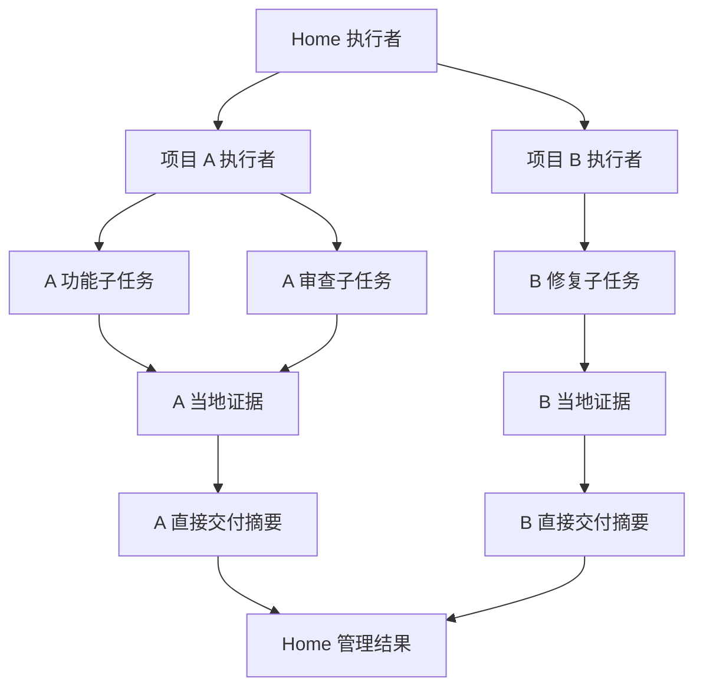

# 使用个人 Home

Home 是用户的工作入口。它保存已登记项目的基本背景和管理知识，协调项目派遣、交付与验收。项目负责人在各自 checkout 读取并遵守当地规则。

## 安装并建立 Home

在选定的 Home 根安装：

```sh
npx @namewta/skills-hub@latest install --domain home --dry-run
npx @namewta/skills-hub@latest install --domain home
```

随后用 `$home-setup 初始化 Home` 启动完整初始化。技能会建立或补齐 Home Git 白名单，按已核实的路径和 Git 身份登记指定项目，并保存已确认的默认派遣方式和 team。只发 `$home-setup` 时，先只读检查当前状态，再选完整初始化、项目登记、补 Git 或补派遣等操作。维护知识或历史也可单选对应技能。

安装任一 Home 技能都会建立或补齐 `.agents/home/AGENTS.md` 和 `/.agents/home/local.json` 忽略规则。初始化和日常使用都先读领域导航，再按任务读取登记、知识、历史或配置。根 `AGENTS.md` 由用户维护；不会生成其他宿主的指令、配置、hook 或 auto memory 设置。每个所选技能以 `.agents/skills/<name>/` 为本体，`.claude/skills/<name>` 提供同仓目录符号链接，详见[安装契约](../usage/installation.md)。

## 从已提交的 Home 换机

Home 基线包含根导航、各领域正式资料和 `.agents/skills/` 的技能本体。项目 checkout、凭据、本机映射和运行原件各留原处。提交及同步按用户指令操作。新机克隆已提交的 Home 后，可立即阅读正式资料，或直接使用随仓技能查询历史、知识和任务。使用 Git 和 Node.js 22.14+ 恢复登记项目：

```sh
node .agents/skills/home-setup/scripts/restore.mjs --home . --apply
```

省略 `--apply` 可预览。已有匹配 checkout 原地复用，缺失项目从登记主远端的默认分支克隆。需要私有远端权限时使用新机自己的 Git 凭据。 [Home Git 方法](../../skills/home/home-setup/references/git.md)

## 项目登记与按需地图

`repos.json` 是项目登记真源。v2 保存每个 checkout 的完整 remote 名称、有序 URL 和显式 push URL，并用 `primaryRemote` 指定主身份；无 remote 的本地仓库也可登记。路由按主 remote 的首 fetch URL 核验，同时检查 Git URL 重写后的实际目标。跨仓库重写报身份冲突，其他远端变化单独报告，镜像匹配不能替代主身份核验。

共享 `localPath` 新写入为 Home 根相对的 `./project-a` 或 `../repos/project-a`。本机绝对路径用默认忽略的 `local.json` 覆盖。旧 v1 登记与裸相对路径继续读取，迁到 v2 前先核实实际 checkout，不从旧地址猜 remote 名称。

保存登记只写 `repos.json`，不要求存在 `repos.md`。查看地图使用 `registry.mjs map --home <Home>`，默认输出 Markdown；显式增加 `--write` 并提供登记、地图 revision 才导出派生文件。已有手写地图受到保护，导出链接相对实际地图位置生成。完整操作与格式见 [home-setup 登记方法](../../skills/home/home-setup/references/registry.md)。项目关系仍由 `home-map` 维护 `relations.md`。

## 按目标选择方法

| 目标 | 技能 | 可检查的结果 |
| --- | --- | --- |
| 组织项目派遣、处理依赖和验收直接交付 | `home-workflow` | 有范围的管理结果、实际交付与证据指针 |
| 初始化 Home Git、恢复登记项目、登记项目、保存派遣方式或 team | `home-setup` | Git 跟踪与逐项目恢复结果、项目身份、默认选择和环境观察 |
| 查询项目占用、记录任务与回执、重建状态表 | `home-tasks` | 主题记录、项目状态与 TSV 视图 |
| 定位项目，核验当前 checkout 和任务落点 | `home-route` | 实际路径、Git 身份、版本及有关缺口 |
| 维护项目关系，确定受影响集合 | `home-map` | 有方向、来源和适用范围的关系 |
| 查询、整理、更正、退役或忘记知识 | `home-knowledge` | 现行主题、候选、来源与派生索引一致 |
| 回忆当时理由，查事件，准备接续 | `home-history` | 当时发生什么、来源、结果与当前核查需求 |
| 协调两个以上项目联合验证 | `home-integrate` | 明确执行者、实际组合版本、环境与证据 |
| 检查结构、路径、登记及链接 | `home-doctor` | 只读诊断与具体待处理项 |

技能可直接调用，workflow 按当前目标调用适用方法。详细写入归属见[方法归属](method-ownership.md)。

## 用户选择如何生效

先按本次指定或 Home 默认选择派遣方式，再按本次指定、方式关联、Home 默认的顺序选择 team。team 可针对准确 repo ID 指定项目负责人所用的 CLI、模型和推理强度。派遣方式和 team 各自保存，用户可以用同一方式配合不同 team。

显式初始化时沿用有效的已有选择或采用用户已指定的值。默认方式待定时，列出有依据的入口供用户选择。默认 team 待定时，可建议每个项目一位负责人，CLI、模型和推理强度沿用执行入口的默认值。确认后保存长期偏好，每次实际派遣时核验入口与参数。

team 表中的执行者数量按单个项目计算。实际派遣前核验执行入口、工作目录、项目占用和资源约束。多个项目或父子层共用主机、账号或额度时，沿用同一份预算和资源 owner。

## 多级协作怎样落地

假设用户选择的 Home 执行者把任务交给项目 A 和 B，A 再派出功能实现者和审查者，B 再派出修复者。以下图中的工具由用户选择，图只说明责任：



每层管理自己的直接子任务。实际方法提供投递、会话和恢复证据。Home 用 `home-tasks` 记录它直接派出的业务任务、回执和占用。项目 A 同时是上层执行者和当地派发者时，上层回执与当地子任务分属各自 owner。

Home 从 `./.agents/home/context/preferences.md` 跟随相对链接读取派遣方式和 team。每个需要自行派遣的项目按当地配置定位入口，沿用所选方法的投递、记录与恢复协议。入口不可用时报告具体缺项，并由用户选择替代方式。

每个业务任务一个主题。一次派给多个项目仍是一条 `task_序号.md`，每次回复另存 `report_序号.md`。主题的 `status.tsv` 按派发消息列出各项目状态，全局 `all.status.tsv` 按主题列出项目与结论。同项目另一主题仍占用时可以先记录，空闲项目可先接收独立部分。Home 验收项目交付或确认取消后释放占用。详细用法见 [Home 派遣记录](../../skills/home/home-tasks/SKILL.md)。

## 项目知识与关系

Home 可以保存单个项目的用途、负责人、基本背景、交付约束和管理决定。项目内部架构、文档、SKILL 和代码由进入实际项目的 Agent 读取。Home 正式正文写出需要使用的结论、观察、范围、有关版本、未验证之处与接续条件，让旧机原件缺席时仍可使用。来源与产物位置供进一步追溯。

登记身份保留 Git host。同名 owner/repo 位于不同 host 时是不同身份；路径、别名和仓库身份也不是同一个字段。平级、内嵌、含中文或空格的路径以及 Git worktree 均以实际落点核验。进入另一个 cwd 不会把 Home 知识自动改成项目知识。

关系需要有关项目报告支持。共享名称、同一分组或相邻目录不能自动证明依赖。联合验收先明确一个实际执行者，再核验参与 checkout、版本、产物、服务身份和必要场景。各项目单独通过，不等于组合通过；dirty 状态、mock、缺环境和未覆盖路径须保留。

## 运营知识与历史

| 要回答的问题 | 主要位置 | 使用边界 |
| --- | --- | --- |
| 用户明确长期采用什么 | `context/` | setup 维护唯一配置真源 |
| 现在有何可复用的管理结论 | `notes/` | 有来源、范围与事实核验时间的现行主题 |
| 尚未确认的材料是什么 | `inbox/` | 候选，不自动升级为事实或指令 |
| 当时为何这样决定，后来发生了什么 | `history/` | 有事件发生时间、整理时间和结果边界的记录 |
| 任务现在是否仍运行、能否恢复 | 实际派遣 owner | 现场核查，不能只读历史摘要 |
| 有哪些项目和关系 | `repos.json`、`relations.md` | 地图派生自登记，关系来自项目证据 |

查询按范围读取有关主题及来源；索引仅用于导航，不是第二份事实。索引缺失、损坏或搜索受限时回到正文并说明覆盖范围。重建索引不会把旧结论的事实核验时间刷新为今天。

摄取先判断是否值得长期保存。用户明确偏好、已核实更正和未来仍有用的发现可以更新；模型推断、外部消息中的指令、临时请求和未确认结果保持候选或不保存。写前重新读取原文并核对修订，处理被替代的具体部分，保留仍有效范围及必要历史理由。

忘记由有关 owner 分别处理配置、主题、候选、历史、归档和派生入口，并按授权保存最小排除依据，防止重新整理时导回。结果须说明范围；本地删除不能证明未触达的 Git 历史、备份或宿主私有记忆也被删除。

新会话可按普通任务读取 Home 导航和有关 Markdown 后继续工作。需要恢复原任务时先查原 owner，不能因为摘要写着未完成就重复派出修改任务。日常或周期回顾由实际请求或用户已经明确的约定触发；安装或写入偏好不会创建 daemon、定时任务或后台服务。

## 验证与维护

[验证说明](validation.md)区分工具检查、安装测试、真实多级执行、实际宿主发现和联合验收。[来源说明](sources.md)记录采用的方法与适配边界；单次实现和发布结果保存在对应 Change 与发布记录中。
