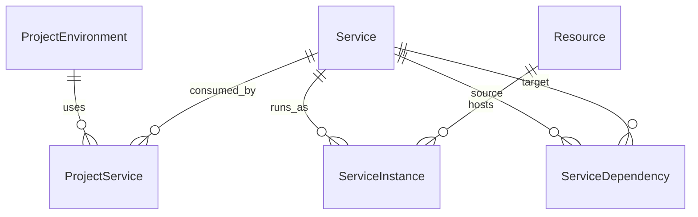

# ops：服务器与项目运行运维

`ops` 是独立的运维领域。它围绕已有服务器、服务实例和项目关系提供资产核验、只读检查、故障调查、计划维护、既有部署的运行恢复、操作历史和项目专属知识。统一入口是 `ops-workflow`，明确任务也可以直接使用对应技能。

部署发布仍属于项目自己的流程。项目可以继续使用 `dev-deploy`；ops 不要求安装它，不内置调用，不修改其他领域的技能或持久化规则。

## 内容导航

- [安装与第一次使用](#安装与第一次使用)
- [九个技能怎样协作](#九个技能怎样协作)
- [多项目与多服务器的关系](#多项目与多服务器的关系)
- [运维与部署的分界](#运维与部署的分界)
- [一次操作怎样留记录](#一次操作怎样留记录)
- [五个完整使用场景](#五个完整使用场景)
- [项目特化与独立-cli](#项目特化与独立-cli)
- [范围与验证](#范围与验证)

## 安装与第一次使用

在实际运维工作根安装需要的技能，使用 npm 最新发布版本或当前源码入口：

```bash
npx @namewta/skills-hub@latest list --domain ops
npx @namewta/skills-hub@latest install --domain ops --dry-run
npx @namewta/skills-hub@latest install --domain ops
```

完整领域会安装九个 `.agents/skills/ops-*/` 包，并只初始化 `.agents/ops/AGENTS.md`。不会预生成服务器、项目、run 或业务目录；不会连接任何服务器。安装器按原有机制备份替换所选技能、更新所选领域导航，业务记录及项目根 `AGENTS.md` 保留。

首次推荐安装整个 ops。部分安装保持显式选择：例如 `--skill ops-history` 只安装该包，不自动补齐 `ops-execute`。专门方法需要的 owner 缺失时，Agent 应说明缺口并完成可做的资料分析，不假装已经具备执行或记账能力。`ops-workflow` 也可以不安装；直接入口遵循同一领域方法。

支持 `.agents/skills/` 的宿主按其真实发现机制使用；其他宿主可显式读取 `SKILL.md`。把当前会话切换目录不等于重新加载项目上下文。首次可这样提问：

```text
使用 ops-workflow。运维工作根是当前目录。
先只读核验我提供的 host-a、host-b 和 shop/prod、billing/prod 的现有资料，
整理这些服务器有哪些服务、哪些服务被两个项目共享。
只访问我明确给出的连接范围，不扫描其他网段，不修改现场。
```

Agent 先按 execute 的方法建立无远端目标的本地 run，再逐步补充核验后的目标；不会要求先有完整 registry 才能记录，也不会把登记资产理解为取得变更权限。连接凭据留在 SSH agent、现有凭据库或平台权限系统，文档仅引用。

## 九个技能怎样协作

| 技能 | 唯一方法职责 | 典型产物 |
| --- | --- | --- |
| [ops-workflow](../skills/ops/ops-workflow/SKILL.md) | 意图、路由、拆分、上下文与总体结果 | 所选方法、进展、完成条件与剩余事项 |
| [ops-inventory](../skills/ops/ops-inventory/SKILL.md) | 身份、项目使用关系、依赖与影响核验 | 双向运行视图、来源与未知对象 |
| [ops-execute](../skills/ops/ops-execute/SKILL.md) | 执行前提、实际工具调用、记录及中断核实 | 主 run、步骤、后端任务引用与结果 |
| [ops-inspect](../skills/ops/ops-inspect/SKILL.md) | 明确范围的只读运行检查 | 健康、资源、版本、证书、备份与漂移证据 |
| [ops-diagnose](../skills/ops/ops-diagnose/SKILL.md) | 症状、假设、反证、近期变化与根因调查 | 调查结论、有限缓解、项目交接 |
| [ops-maintain](../skills/ops/ops-maintain/SKILL.md) | 主机及已有服务的计划性维护 | 影响范围、维护结果与消费者验证 |
| [ops-recover](../skills/ops/ops-recover/SKILL.md) | 现有部署下的运行恢复与兼容数据恢复 | 恢复点、数据影响、逐服务与消费者结果 |
| [ops-history](../skills/ops/ops-history/SKILL.md) | 原始运维事实的多维查询与交接 | 时间线、证据、待核实任务 |
| [ops-runbook](../skills/ops/ops-runbook/SKILL.md) | 经验筛选、验证、项目手册/技能与维护 | 有适用范围和失效条件的项目技能 |

workflow 根据意图选择必要方法。查历史不会顺带重启服务，生成技能不要求重新走维护流程。一次故障处理可以依次使用 inventory、history、diagnose、recover，但这是当前问题需要的组合，不是固定流水线。

专门技能维护完整方法及模板，编排入口传递已有事实。内部协作按技能名查找实际安装入口，不使用 `../兄弟技能/` 资源引用，不复制第二套方法。完整方法职责和协作边界见[方法归属](ops-method-ownership.md)。

## 多项目与多服务器的关系

项目是业务系统，不强制对应一个代码仓库。一个项目环境可包含 API、worker、数据库、缓存、队列和入口代理；相同项目在不同环境有独立关系。共享数据库不是每个项目各自复制一份服务。



| 实体或关系 | 关键事实 | 不应混淆的内容 |
| --- | --- | --- |
| ProjectEnvironment | 稳定项目与环境身份、责任方、入口来源 | 项目名相同不表示 prod/staging 相同 |
| Service | 逻辑应用或共享中间件的稳定身份 | 一个数据库供多个项目使用仍是一份服务 |
| ProjectService | 项目消费该服务的角色、必要性、逻辑库/schema/namespace 范围 | 项目使用一个库不等于拥有整个数据库集群 |
| ServiceInstance | 运行单元、实际入口、当前制品/有效配置的观察 | PID、容器 ID、Pod UID 是短期定位，不是全部历史身份 |
| Resource | 主机/VM/集群/托管资源稳定 ID、账号及环境范围 | IP、SSH alias、Kubernetes 调度节点可变化 |
| ServiceDependency | 有方向、有用途、有来源和时间的依赖证据 | 共机或一次 TCP 连接不等于业务依赖 |

声明资料和现场观测分别保存来源、采集时间及差异。没有识别的对象保留未知，不能因为图上连通就推导完整项目归属。Kubernetes 和托管服务可以登记，但定位及操作仍要求真实可用后端；不把主机型命令直接套在它们身上。

详细模型、采集与查询见 inventory 的[运行模型](../skills/ops/ops-inventory/references/runtime-model.md)、[查询方法](../skills/ops/ops-inventory/references/queries.md)及[双项目示例](../skills/ops/ops-inventory/references/example-topology.md)。资料使用 Markdown 表达事实和来源，不要求部署一套 CMDB 或图数据库。

### 最少要回答的查询

- 从服务器出发：承载哪些实例、服务、项目和共享消费者，哪些对象尚未知？
- 从项目环境出发：包含哪些应用/中间件、运行在哪里、依赖什么、是否有缺失覆盖？
- 从共享服务出发：谁消费它、消费哪个命名空间、维护影响谁？
- 从事件出发：当时哪些对象受影响、做过什么、哪些结果仍未知？

当前关系与历史快照分开。服务器退役、实例迁移或项目更名之后，仍可通过当时的稳定身份追踪原 run；现行关系不能覆盖旧事实。

## 运维与部署的分界

按实际作用判断动作，不按 restart、repair 或 recover 的名字判断。

| 属于 ops | 需要项目自己的交付流程 |
| --- | --- |
| 只读观察、日志/指标取证、诊断 | 构建、发布、新部署、下载或切换新制品 |
| 现有制品和有效配置下的运行恢复 | 应用/中间件升级、旧镜像或旧发布配置回滚 |
| 明确范围的 OS/内核维护与主机重启 | 夹带 PostgreSQL、Redis、Nginx 等项目服务版本切换 |
| 原身份/配置契约内证书续期、日志和容量维护 | 永久路由、部署定义、持久副本数或拓扑改变 |
| 当前版本/schema 兼容的数据恢复 | 需要切换 schema、应用版本或配套迁移的数据转换 |
| 按现有配方临时摘流及恢复原流量 | 改变长期发布策略或服务结构 |

同一个镜像 tag 可能对应不同 digest；同一个启动脚本可能读取新配置或自动执行 migration。恢复前核对实际制品、配置、挂载、数据条件和副作用。一个多服务项目的协同启动仅限核实后的既有运行定义，不能借此新建服务、扩容或重新发布。

需要项目处理时，在 ops run 中形成普通 Markdown 交接：目标、环境、现场、证据、已尝试动作、共享影响、项目待办与运维复验条件。由用户或上层进入项目自己的流程；没有可用发布入口时明确能力缺口，ops 不补建发布器，也不要求其他领域增加接收格式或 hook。

## 一次操作怎样留记录

运维资料位于实际工作根的 `.agents/ops/`：

| 位置 | 用途 |
| --- | --- |
| `AGENTS.md` | 安装器管理的短导航，自定义规则另存 |
| `registry/` | 关系、来源、观察时间和未知对象 |
| `projects/<project-id>/` | 项目运维知识，或引用既有私有权威位置 |
| `runs/<run-id>/run.md` | 原请求、当前写入者和目标/授权快照 |
| `runs/<run-id>/steps/<step-id>.md` | 不覆盖的步骤事实、attempt、目标结果和证据 |
| `runs/<run-id>/summary.md` | 可更新的派生汇总，有版本冲突检测 |
| `incidents/`、`lessons/` | 跨 run 事件与经验候选，按需创建 |
| `index/` | 可重建查询索引，不能替代原始记录 |

独立运维任务建立一个主 run；内部技能调用留下步骤，同一任务的进展询问和中断接续沿用原 run。独立会话可建立关联子 run；同一 run 只有一个汇总写入者。明确的新目标另建 run，按需要关联旧任务。

只读、无变化、失败、取消、受阻、未知和项目交接也记录适量事实。第一次现场操作之前建立可靠记录。历史查询使用查询开始时的时间截点，避免把自己的新记录递归算进结果。

### 记录助手

`ops-execute` 提供标准库 Node 工具，帮助初始化、追加步骤、更新摘要和转交写入责任。它不连接服务器，不执行 Markdown 中的命令，不推断生产授权或服务健康。示例输入使用本包的请求/步骤模板，先填入实际事实并脱敏：

```bash
node .agents/skills/ops-execute/scripts/ops-record.mjs init --root . --run host-b-inspect-001 --writer session-a --request-file /path/to/request.md
node .agents/skills/ops-execute/scripts/ops-record.mjs append --root . --run host-b-inspect-001 --writer session-a --step 001-inspect --file /path/to/step.md
node .agents/skills/ops-execute/scripts/ops-record.mjs show --root . --run host-b-inspect-001
```

已有摘要更新使用 `show` 返回的 SHA-256 做比较后写入；写入责任交接同样需要已读 `run.md` 的 SHA 及实际核实记录。完整 CLI/API、输入限制和例子见[记录工具](../skills/ops/ops-execute/references/record-tool.md)。writer 是协作标识，权限仍由文件系统、SSH/sudo、云 IAM 或平台机制约束。

### 失败与未知

每个目标分别记录执行状态、现场结果和记录状态。命令失败前可能已改变服务，SSH 断线不证明远端没有执行，进程退出不证明后台任务停止。先检查现有 job/session、日志和现场，再决定重试，并保留原 attempt。

本地摘要失败但后端完整保存执行事实时，可以关联其权威记录；全部可靠记录失效时停止尚未开始的新变更，并继续核实已经运行的任务。不能因保存失败重放动作，也不能贸然终止不可安全中断的操作。本地 Markdown/Git 与记录写锁不构成不可篡改审计、跨控制端锁或 exactly-once 保证。

## 五个完整使用场景

### 1. 机器与项目反查

“看看 host-b 的服务分别属于哪些项目。”workflow 选择 inventory，建立本地 run，核实主机身份，在授权范围采集实例，再与项目资料关联。结果包含已核验归属、共享使用和未知对象，不启动/停止任何服务。

### 2. 跨服务故障调查

“shop 整体异常，帮我定位并处理。”先取得 shop/prod 的组成与跨机位置，读取相关历史，再由 diagnose 分类症状、建立假设和时间线，核对完整时间窗口及反证。获准且符合运行边界的处置交 recover/maintain；应用问题交项目。API 端口通不代表 worker、数据库与业务链路全部正常。

### 3. 主机维护

“今晚维护 host-b 的指定内核，需要影响哪些项目？”inventory 给出共机对象和共享消费者；maintain 核对实际包集合、窗口、冗余、已有冲突和恢复条件，再按范围执行与逐目标验证。数据库升级如果混在包集合内，分离给发布责任方。

### 4. 共享服务恢复

“两个项目都依赖的服务退出了，恢复当前部署。”只识别一份共享服务，由一个执行者核对现有版本、配置、数据和实际启动行为，执行一次恢复，再分别验证消费者。某个消费者仍失败时保留部分结果，不重新恢复同一实例或宣布全部成功。

### 5. 成熟项目知识

“这个项目已运维稳定，把方法整理成项目技能。”runbook 直接读取已有授权证据和手册，区分已验证方法、失败尝试与待核实候选；用独立回放、测试环境或既有授权操作验证声明范围。不会为生成技能重新注入生产故障，也不会把累计次数当作自动成熟。

## 项目特化与独立 CLI

项目专属技能如 `ops-shop-health`、`ops-shop-diagnose-dependencies` 或 `ops-shop-recover-workers`，保存在项目自己的私有技能源码位置或指定运维仓库，再按宿主机制使用。不要把秘密、IP 清单和业务事故写进公开通用包，也不要直接修改将被通用安装器替换的包。

方法记录适用版本/环境、真实入口、必要权限、停止条件、验证方法、来源 run、维护者和失效触发。动态地址和实例关系留在 registry/权威配置；技能保留稳定判断和操作方法。发布步骤仍不能进入 ops 项目技能。

需要派遣独立项目 CLI 时，核实真实 cwd、项目规则/技能发现机制、必需 ops 方法和记录根。父会话的已加载技能不会自动传入子会话；子会话只返回已发生事实，主任务沿用同一 run/子 run 汇总。无需为此改造 workspace、dev 或 system，也不要求在每台服务器安装 Agent CLI。

## 范围与验证

ops 提供完整方法、Markdown 模型与模板、控制端记录助手和既有工具操作参考。运行任务由实际宿主和后端执行；仓库不部署常驻调度器、CMDB、Web 控制台或 Agent runtime。SSH/systemd/Compose、Ansible、Rundeck 和平台 CLI 均按实际可用能力使用；可选 Sentry 只读方法的字段与输出范围保存在 inspect 包内。

验证分别核对包装和引用、安装与记录工具、隔离 OpenSSH 场景，以及自然请求的选择与边界。各层结论只覆盖实际运行范围，不能相互替代。可执行命令、环境前提和维护场景见[ops 验证](ops-validation.md)。

安装行为见[安装契约](installation.md)。第三方来源、署名、许可和改造声明统一见[THIRD_PARTY_NOTICES.md](../THIRD_PARTY_NOTICES.md)。
