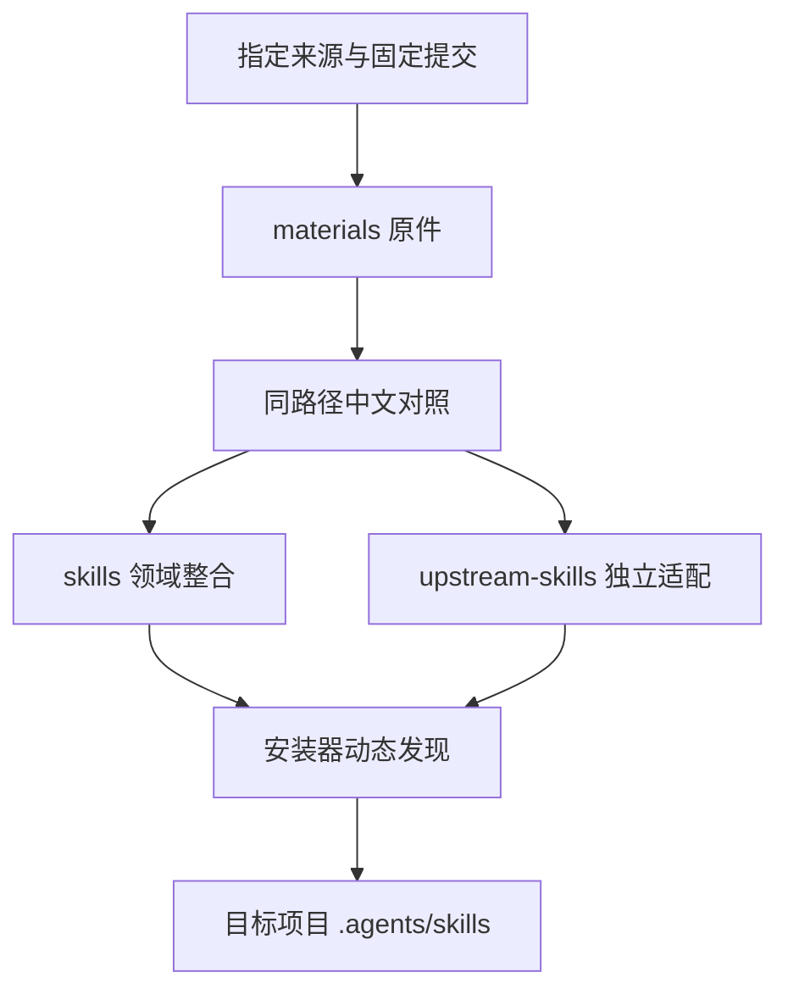

# 项目架构

skills-hub 是技能源码、来源对照和安装工具的仓库。安装器把选中的完整运行包复制到目标项目；Agent 在自己的宿主中读取技能，按当前任务使用方法与工具。仓库没有独立的 Agent runtime、任务调度服务或自动执行技能的安装阶段。

## 目录与职责

| 位置 | 职责 | 是否进入目标项目 |
| --- | --- | --- |
| `skills/<domain>/<domain>-xxx/` | 按 dev、ops、system 等领域整合的中文方法 | 选中后完整安装 |
| `upstream-skills/zh-<原名>/` | 保留独立结构与工具语义的上游中文运行包 | 选中后完整安装 |
| `materials/<source>/upstream/`、`zh/` | 固定来源快照与同路径中文对照 | 不安装；维护检查按明确入口使用 |
| `materials/manifest.tsv` 与各来源 `manifest.tsv` | 来源身份、逐文件映射和运行核对依据 | 不安装 |
| `install.mjs`、`cli.mjs`、`tree-select.mjs` | 发现、选择、预览、安装与交互 | 作为 npm 工具运行，不复制进技能 |
| `scripts/init-persistence.mjs`、`scripts/persistence/` | 所选领域的托管导航模板 | 只生成或更新约定的 `AGENTS.md` |
| `scripts/`、`tests/` | 维护检查、隔离测试、同步与发布 | 除安装所需初始化资源外不分发 |
| `docs/` | 长期架构、用法、接口与开发规范 | 不安装 |
| `.agents/dev/` | 本仓库开发过程、项目知识和发布记录 | 不安装 |
| `licenses/`、`THIRD_PARTY_NOTICES.md` | 第三方声明与法律原文 | 随源码及 npm 分发；包内原生法律文件随对应技能保留 |

原件、译文和运行包的差别见[资源组织](resources.md)。法律范围和具体来源以[统一第三方声明](../../THIRD_PARTY_NOTICES.md)为准。

## 两类运行包共用安装接口

领域表示长期协作的方法体系。例如 dev 的规格、计划、实施和验证之间有明确交接，ops 的资产、调查、恢复和历史共享运行记录。每份完整方法有一个负责技能，其他技能按名称调用它。

独立上游技能可以只解决一个任务，也可以由一个来源仓库提供多个入口。它们使用 `zh-<原名>` 安装名，在 CLI/TUI 中归入 `upstream-skills`。这个分组没有自己的工作流或持久化根；技术主题和 GitHub 语言统计不决定 domain。

两类包最终都位于 `.agents/skills/<技能名>/`，安装名全局唯一。安装器不自动解析兄弟技能依赖。调用者需要某方法时读取实际安装的入口；缺少所需包时报告具体缺口。需要整套协作能力时按领域安装，独立任务可以只选所需入口。

## 从来源到运行包

材料同步只更新所选来源的原件、对照及映射，报告受影响的运行路径。运行包需要另行阅读、合并和验证，安装时也不会从材料临时拼接文件。`runtime_paths` 表示采用关系，`runtime_reviewed_blob` 表示最后实际核对的来源对象；同步新快照不自动把运行版标为已升级。

材料不参与技能发现或安装，也不自动加载其中的指令、CI、hook 或依赖。维护回放有一个明确用途：从固定材料 corpus 复制捕获夹具到临时目录，由本项目状态图工具加载其中的 `view.mjs` 投影配置并回放保存的输出。该过程不运行新 TLC，也不授权执行任意来源脚本，详见[验证指南](../maintenance/validation.md#行为与工具检查)。

## 安装器的组件边界

| 组件 | 接收与返回 | 负责的行为 |
| --- | --- | --- |
| `install.mjs` 的 `catalog()` | 从两个运行根读取目录和 `SKILL.md`，返回领域、安装名、路径和描述 | 动态发现、命名和唯一性检查 |
| `select()` | 目录、领域名、技能名及全选选项 | 选择取并集、去重，拒绝未知名称 |
| `createInstaller().plan()` | 已选技能与真实项目根 | 检查目标和冲突，计算 install/replace/unchanged |
| `createInstaller().apply()` | 同一选择和项目根 | 加锁、暂存、备份、切换、导航更新及普通异常恢复 |
| `cli.mjs` 与 `tree-select.mjs` | 终端输入与目录数据 | 搜索、分页、跨组选择及确认，再调用同一安装核心 |
| `scripts/init-persistence.mjs` | 最终选择的领域 | 规划和写入固定导航，保留业务记录 |

这些模块接口用于仓库实现和测试；面向使用者的命令契约见[安装说明](../usage/installation.md)。显式 CLI 使用 Node 标准库完成文件操作，交互模块按需加载 npm 的终端 UI 依赖。

安装目标由当前工作目录决定。安装器先检查全部所选包及导航路径，取得新旧兼容锁，再在同一文件系统暂存和切换。不同内容先备份再替换；普通异常按日志恢复本次切换和导航。断电、强制结束或外部并发修改不属于完整事务保证，恢复方式见[更新与冲突](../usage/installation.md#更新与冲突)。

## 技能、项目资料与宿主能力

技能保存可复用的方法。目标项目的 `.agents/dev/`、`.agents/system/`、`.agents/ops/` 保存该项目的事实与过程；安装目录不承载这些记录。安装器只更新自身管理的领域导航，任务执行时按内容建立业务文件。完整职责见[持久化目录](persistence-roots.md)。

宿主负责发现技能、提供模型、文件访问、子代理和外部工具。技能中的调用名称不等于每个宿主都存在同名 API；自动发现、并行或后台执行都需要实际能力支持。独立包保留原有工具前提，外部工具的最新响应也不因本地翻译而自动变成中文。

## 验证和分发边界

自有技能检查中文元数据、入口预算、包内资源可达性和方法唯一归属。独立上游包保留必要结构和 metadata，检查安装名、本地引用、中文入口和完整分发。两者都核对来源映射，但使用不同的适配规则。

统一结构检查、隔离行为测试、捕获输出回放、真实 npm 包安装和专项运行检查分别回答不同问题。它们的入口及结论范围见[验证指南](../maintenance/validation.md)。发布使用通过验证的同一提交和同一个 tarball，并核对 npm 与 GitHub 附件完整性；流程见[发布指南](../maintenance/release.md)。
