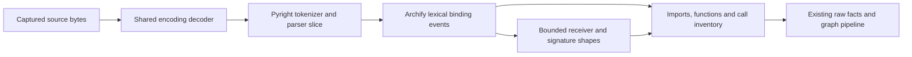

<a id="python-source-analyzer"></a>

# Python 源码分析器

Python 提取完全在 Node 中运行。tokenizer、parser、源码位置和必要解析诊断来自 **Pyright 1.1.414**，提交 `a28cce4077d87b80bead12de809f79845e39c8ba`。解析器提供语法树和 token 位置；Archify 用它们收集导入、测量函数、列出调用并定位唯一源码声明。

<a id="runtime-and-version-selection"></a>

## 运行环境与版本选择

提取不需要 Python 可执行文件或 Python 包。宿主解释器版本与 `BAUIFY_PYTHON` 都不选择语法。默认目标为 Python **3.14**。在现有分析配置中选择更早语法：

```json
{
  "python": { "targetVersion": "3.12" }
}
```

支持 `3.8` 到 `3.14` 的字符串目标。不支持的目标明确失败，不静默限幅。设置控制语法检查；不选择已安装环境、不加载依赖、不解释 `pyproject.toml`、不提供版本特有标准库类型，也不建立完整 Python 编译／类型检查有效性。

语法矩阵覆盖赋值表达式（3.8）、带括号的 `with`（3.9）、`match`（3.10）、`except*`（3.11）、PEP 695 类／别名及 PEP 701 引号复用（3.12）、类型参数默认值（3.13），以及模板字符串／多个裸异常类型（3.14）。十个案例全部对七个目标检查。3.12 之前的 f-string 引号／反斜杠检查来自 Pyright checker 的必要部分；只复制 parser 会遗漏这些检查。

<a id="data-flow"></a>

## 数据流



| 能力 | 当前行为 |
| --- | --- |
| 文件选择、角色及捕获字节 | 既有 Archify 快照策略 |
| 包导入 | 既有已捕获 `.py` 解析器、相对导入、`src`、命名空间包及隐式 `__init__.py` 边 |
| 导入执行证据 | eager/deferred、条件、`TYPE_CHECKING`、字面／计算型标准加载器，并用词法重新绑定守卫保护 |
| 模块符号 | 函数、类、导入及赋值；保留首次绑定行 |
| 函数与指标 | 限定名、精确范围、所属装饰器范围、McCabe 复杂度、嵌套及最深行 |
| 调用盘点 | 语法有效文件中每个语法调用，含嵌套函数体／默认值；未解析点仍保留在盘点中 |
| 直接目标 | 唯一未装饰模块函数、唯一前置函数局部 from-import，以及一次显式再导出 |
| 额外声明目标 | 捕获模块成员、接收者注解、`self`／`cls`、构造出的接收者及声明返回值。源码继承／C3、零参数 `super`、属性及选定装饰器。有限局部流程含断言、短路守卫、有类型推导式及可到达导入。 |
| 类型与依赖签名 | 稳定 `TYPE_CHECKING` 导入、保留 callable 的装饰器、PEP 695 参数、带约束的旧 TypeVar、`type[T]` 工厂及显式依赖声明。匹配简单字符串和布尔重载提供返回类型。声明的 `Callable` 可为紧接的 lambda 实参赋型。 |
| 源码正确性 | 从 1 起算的 UTF-16／排他结束位置、解码切片哈希、BOM／PEP 263 解码、独立入口／目标新鲜度 |
| 解析失败 | 文件局部错误，不把函数／调用归入该文件；空盘点不能声称已知零覆盖 |

接收者及签名形状标识源码**声明锚点**。经 `Base` 注解的调用可指向 `Base.method`，即使运行时分派选择子类。类构造表达式可以建立接收者形状，不必让构造调用本身成为函数目标。不导入、执行或构建目标代码。

写入在查找前收集，因此后续局部赋值不能回退到外部函数。方法体跳过类词法命名空间。可调用字段写入、冲突或未知的可到达绑定、私有名称不确定性及任意装饰器，会阻止不支持的目标。只有具备绑定证据，才识别内建 property/classmethod/staticmethod 和选定的导入 contextlib 装饰器。

注解可以解析位于可识别 `typing.TYPE_CHECKING` 守卫下的唯一导入。运行时表达式仍使用自身绑定。捕获装饰器若唯一普通参数及返回使用相同、以 `Callable` 为约束的类型变量，可以保留声明签名。普通类实参可以特化显式 `type[T]` 或 `typing.Type[T]` 工厂签名；替换将实参捕获的类身份带入返回类型。

局部值形状跟随调用点的赋值。分支汇合所有可能定义；可能未绑定的路径或冲突接收者不会成为唯一目标。循环包含循环携带写入。异常路径及上下文管理器抑制保留不确定性。标准容器／生成器／上下文协议需要可识别导入或实际内建名称，不仅依据拼写。这些规则跟随声明和签名，不执行目标代码。

两个模块级无参数定义若共享返回注解，并位于经验证 `sys.platform` 检查的相反分支，可提供一个导航锚点。此场景中，后一个定义遵循 Pyright `All` 平台导航。接收者联合只有在每个可能接收者都指向相同捕获声明时才提供目标。

捕获的继承层次完整时，源码继承使用 C3。可在检查第一个捕获基类的外部尾部基类前，选择直接位于该基类的声明：在每个一致的 C3 顺序中，它都先于后续基类。可能的继承声明之前存在未知基类、环或不一致顺序时，仍为未知。这不证明整个类能编译。

<a id="supplying-dependency-declarations"></a>

## 提供依赖声明

项目源码依赖另一个包定义的工厂或接收者签名时，传入分析配置。

```json
{
  "python": {
    "declarations": { "dependency": "types/dependency.pyi" }
  }
}
```

每个键是导入模块名。提供 `.py`、`.pyi` 文件，或具有匹配模块路径的包目录。路径可绝对，也可相对被分析根。`.pyi` 优先于匹配的 `.py`。声明输入应位于捕获项目源码选择范围之外。通过已有 `--config` 选项或库的 `config` 参数传入配置。

Archify 在 Node 中解析声明输入，并在 `languageScope.declarations` 记录相对文件名及字节哈希。它们可辅助局部方法导航。项目盘点和依赖边仍描述被分析树，导航目标仍指向捕获的项目定义。默认声明映射为空。没有配置或捕获签名的项目导入，可能使依赖它的接收者保持未解析。

<a id="explicit-limits"></a>

## 明确限制

运行时**不包含** Pyright 的 Program、LSP、binder、类型求值器、typeshed、环境解析器或 CLI。其 binder 和类型形状由 Archify 自行实现，不能描述为 Pyright 完整语义引擎。准确性提升来自语法实现和具体绑定算法，不是来自 TypeScript 语言本身。

未解析领域包括外部／仅 stub 目标、任意值／回调流、动态属性／元类、运行时 monkey-patching、通用重载选择、歧义联合、超出有限局部规则的通用控制流／类型推断、无约束旧泛型推断，以及更长再导出链。复杂条件导入、任意装饰器、描述器和上下文代理仍可能阻止声明。歧义调用点保持未解析。完整 Pyright 为这些差距提供开发参考。

<a id="model-and-history"></a>

## 模型与历史

Revision **17** 输出 `python-source-v3`，适配器身份为 `pyright-parser@1.1.414/python-3.14`（或所选语法目标）。新目标使用 `python-source-declaration`，必须匹配捕获函数定义起点。Revision 11 的 `python-source-v1` 保留其接收者／签名范围。Revision 12 增加有限局部流程及协议形状、属性访问器、带约束 TypeVar、限定 contextlib 装饰器和源码 `super` 声明。Revision 13 增加仅类型注解导入、有类型装饰器约定，以及带显式依赖输入的泛型工厂返回。Revision 14 在能验证导入绑定时跟随显式 `typing.cast` 注解与 `functools.cache` 声明。序列导航要求标量索引。Revision 15 扩展有限流程、有类型回调参数、简单重载返回、已知描述器及配对平台定义的函数导航。Revision 16 将成功 `try` 绑定带入 `else`，跟随通配导入之后的局部声明，以及经验证缓存和 single-dispatch 装饰器；它在空列表后备分支中保留有类型元素，在不同方法间保留共用返回类型，并可导航调用点使用的属性。显式 `Any` 保持未知，直到受支持类型守卫提供更多证据。Revision 17 跟随映射中的 tuple 键、终止的内建 `object` 基类，以及断言消息内的失败条件。已有 `same-file-function` 和 `imported-function` 证据含义不变。阅读器继续接受历史 `python-source-v1/v2`、`python-lexical-v1/v2` 及 `python@...` 捕获，不扩展保存的覆盖。更换引擎或语法目标会改变适配器身份，因此比较报告提取器变化，不假装它是源码变化。

<a id="source-maintenance-and-license"></a>

## 源码维护与许可

`extract/py/upstream/UPSTREAM.json` 记录精确上游提交、原始文件哈希、已评审本地哈希及修改。保留 MIT 许可和上游版权头。受版本管理的 Node bundle 带许可标头；分发声明标识来源子集。

```sh
npm run build:python
npm run check:python
npm test
```

开发使用 esbuild。包与源码 checkout 加载相同的已提交 bundle。`check:python` 拒绝过期 bundle 并检查 TypeScript 源码；它也在模块测试套件前运行。更新上游需要评审记录的源码变化、刷新来源信息，并运行语法、绑定、编码、历史及固定项目差异检查。
