<a id="explainer-authoring"></a>

# 解释页创作

解释页将有结论和一定结构的回答（解释、比较、决策、诊断、评审或计划）做成一页。页面以结论开头，用面板展示推理：图表、表格、步骤和短文。何时生成，以及选择启用的模式，见 Skill 的“选择产物”。绘制系统的请求使用原生图表类型。

本指南定义完整草稿语言，直接据此编写草稿。

<a id="draft"></a>

## 草稿

编写一个 Markdown 文件 `candidate.archify.md`。标题后的第一段是直接结论，紧接着的平级列表给出最多四条理由。每个 `##` 标题开始一个面板。

```md
# Why does the first HTTPS visit take an extra round trip? {#tls-first-visit}

The browser and server must agree on keys before any request is sent: **one extra round trip** with TLS 1.3.

- The browser sends its key share in the first message, so one round trip is enough.[](source:rfc8446)
- The server replies with its key share, then its certificate, already encrypted.
- A returning browser can resume and send data immediately.

@answer scope="TLS 1.3 · first visit · no proxy"
@meta locale=en
@source rfc8446 title="RFC 8446: TLS 1.3" url=https://www.rfc-editor.org/rfc/rfc8446

## What is exchanged before the first request? {#handshake}

@sequence id=handshake-flow title="TLS 1.3 full handshake"
| actor browser | Browser | frontend |
| actor server | Server | backend |
| browser | server | ClientHello + key share |
| server | browser | ServerHello + key share | return |
| server | browser | Certificate + Finished (encrypted) | return |
| browser | server | Finished + GET / | emphasis |
| server | browser | 200 OK | return |

@steps id=handshake-steps
| hello | ClientHello | Offers cipher suites and a key share. | handshake-flow | browser |
| reply | ServerHello | Picks a suite and sends its key share; the certificate follows encrypted. | handshake-flow | server |
| done | Finished | Both sides confirm the keys; the request rides along. | handshake-flow | browser |

## How does TLS 1.3 compare with 1.2? {#versions}

| Criterion | TLS 1.2 | TLS 1.3 |
| --- | --- | --- |
| Round trips before data | Two {caution:Slower} | One {good:Faster} |
| Resumed connection | One | Zero {good:0-RTT} |
```

使用[交付](#delivery)中的命令交付。

<a id="rules-that-keep-a-draft-valid"></a>

### 保持草稿合法的规则

- ID 在整份文档中唯一：面板、块、图表和步骤共享一个命名空间。只有步骤、链接或 patch 要定位块时，才给块设置 `id`；callout、facts 和 list 省略它。根据图表内容命名（`handshake-flow`），不要根据所在面板命名（`handshake`）。
- 正文是纯文本。文件路径、glob、`<placeholders>`、运算符和代码用反引号包裹：正文中裸露的 `<`、`>` 或 `*` 会被当作 HTML 或强调而失败。行内代码按字面显示。
- directive 行是管道行，每行一条，列数必须符合文档：`| first | second |`。单元格内部的字面管道写成 `\|`。空行，或下一个 `##`／`@` 行，会结束这些行。
- directive 参数采用 `key=value`；含空格的值使用双引号和 JSON 转义。
- 使用下方紧凑行格式绘制原生图表。只有特殊情况才使用行内 JSON spec。
- 嵌套列表、原始 HTML 和其他 Markdown 扩展会失败，并给出定位诊断，指出行号、组件和修复示例。

<a id="choose-the-form-by-the-shape-of-the-information"></a>

## 按信息结构选择形式

图表替代原本用于描述它的段落。回答涉及关系、流程、按时间发生的交互、层级、历史或数据模型时，把它画出来。典型页面包含结论、一张图，以及一到两个表格或步骤列表。

| 信息结构 | 形式 |
| --- | --- |
| 多方之间按顺序交换消息：协议、请求路径 | `@sequence` |
| 包含步骤和分支的流程：分诊、推出、审批 | `@workflow` |
| 系统组成及其连接 | `@architecture` |
| 层级：目录、模块、分类 | `@tree` |
| 随时间发生的事件：事故、发布 | `@timeline` |
| 带字段和关系的实体 | `@erd` |
| 按多个标准比较选项 | 带 `{good:…}`、`{caution:…}`、`{bad:…}` 单元格的 Markdown 表格 |
| 有顺序的动作、检查或阶段 | `@steps` |
| 阅读者必须执行或验证的事项 | 任务列表，`- [ ] item` |
| 警告、开放问题或关键限定 | `@callout` |
| 几个带标签的事实 | `@facts` |
| 跨项目或随时间的数值比较、整体占比、2×2 优先级、数量流动 | ```` ```mermaid ```` 图表围栏 |
| 一个数值与限制的对照 | `@metric` |
| 仓库中已有的代码 | `@code` |
| 代码变更 | `@diff` 或 ```` ```diff ```` 围栏 |
| 尚不存在的命令、配置或代码 | 普通围栏 |

讲解图表的步骤属于图表所在面板：页面将它们显示在图旁，每个步骤照亮对应部分，阅读者可以逐步浏览。每步标题使用其指向节点的标签，使文字和图表一眼对应；detail 列说明在那里做什么。

简短回答使用小页面：结论加一到两个面板。解释工作原理、诊断或检查清单的问题，通常需要三到五个面板。

<a id="writing"></a>

## 写作

面向会依据页面行动、也可能核查页面的读者写作。使用用户语言。

- 结论首先被阅读；之后每个面板都支持、限定或应用结论。没有内容需要支撑时就停止。
- 覆盖读者采取行动所需内容：结论背后的机制、如何核查，以及何时不成立。细心读者接下来会问的问题，应得到一个面板、表格行或 scope 中的一行；缺少某事实会使读者误解时，该事实就不是可选的。
- 每个面板回答一个问题，每句话提出一个主张。表格或图表已经展示的主张，不再复述；文字补充原因或例外。
- 标题、面板、图表标签和表头中，同一事物保持同一术语，优先使用读者自己的用词。页面会把正文中的名称链接到同名节点，使读者能在图上指向它。
- 结果附带证据：数值带单位、文件位置、来源。值未知或为估计时，在 scope 中说明。
- 对读者无法独立核查的每个主张，引用 `@source`：协议细节、阈值、基准数字、API 行为。无来源经验法则应明确标为经验法则，或省略。
- 交付前重新计算每个派生数值，并展示一次算式：“1000 个请求中 990 个为 80 ms → P99 = 80 ms；11 个慢请求 → P99 = 600 ms。”表格中的合计必须对得上。
- 把动作写成祈使句，触发条件放在前面：“如果迁移报告 schema 不匹配，先回滚，再重试。”
- 读者必须执行或验证时，以检查清单面板结尾：`- [ ] item`，每项一个具体检查。读者可以在页面中勾选。

英文：短句（约不超过 25 个词）、常用词（use、before、to、because），采用有明确执行者的主动语态。

中文：短句，每句不超过约 50 字；动词直接用（检查、决定，而不是进行检查、做出决定）；一句话里的“的”不超过两个；数字后写清边界（超过 3 次、不超过 1 秒）；用具体结果代替套话（赋能、全方位、至关重要）。

<a id="compact-native-diagrams"></a>

## 紧凑原生图表

写 `@<type> id=<diagram-id> title="..."`，后跟管道行。每个都编译为完整的原生 Archify 图表，带原生校验和布局，并可从页面打开完整查看器。一份文档最多包含四个原生图表。

任何 node、actor 或 entity 行都可在末尾添加 `source:<id>` 单元格，指向已声明的 `@source`；悬停该节点时显示来源，若是仓库文件还会显示固定的源码行，使代码图兼具代码导览作用。

节点与参与者类型：`frontend`、`backend`、`database`、`cloud`、`security`、`messagebus`、`external`（默认 `backend`）。边与消息 variant：`default`、`emphasis`、`security`、`dashed`；Sequence 还接受 `return`。ID 以字母开头，只使用字母、数字、`-` 和 `_`。

**`@sequence`**：先声明 actor，再按顺序声明消息。

```md
@sequence id=cache-read title="Cache miss"
| actor api | Order API | backend |
| actor redis | Redis | database |
| api | redis | GET order:42 |
| redis | api | nil | return |
```

actor 行：`actor <id> | label | type`。消息行：`from | to | label | variant?`，其中 `from` 和 `to` 为 actor ID 或 label。`phase | label` 行在后续消息上打开一个带标题的区域，直到下一个 phase：`phase | TCP handshake (1 RTT)`。

**`@workflow`** 和 **`@architecture`**：先节点，后边。摆放从没有入边的节点开始，沿边从左向右进行。

```md
@workflow id=triage title="Latency triage"
| alert | Alert fires | external |
| split | Check percentiles | backend |
| trace | Compare slow traces | backend |
| fix | Fix the cause | backend |
| alert > split | |
| split > trace | tail only |
| trace > fix | cause found | emphasis |
```

节点行：`id | label | type?`。边行：`from > to | label? | variant?`。节点会加宽以容纳标签，因此节点 label 用几个词命名步骤（最多约 10 个中文字或 4 个英文词），细节交给 `@steps`。边标签控制在一到两个词。以 `?` 结尾的节点标签绘制为决策；用答案标注其出边（`yes`、`no`、`是`、`否`）。

将流程步骤归为 phase：声明 `lane <id> | label` 行，再在每个 Workflow 节点的第四个单元格给出所属 phase。最多六个节点绘制为一行，phase 标签在上方；更长流程换行为每个 phase 一行。

```md
@workflow id=p99-flow title="P99 triage"
| lane confirm | Confirm the symptom |
| lane locate | Locate the cause |
| alert | P99 up, mean flat | external | confirm |
| window | Align window and percentiles | backend | confirm |
| sample | Sample slow requests | backend | locate |
| fix | Fix and verify | backend | locate |
| alert > window | |
| window > sample | tail grew |
| sample > fix | cause | emphasis |
```

Architecture 允许十二列。互相通信的组件使用 `@architecture`；读者要依次执行的步骤使用 `@workflow`。

**`@tree`**：每个节点一行，`id | label | parent`；根节点的 parent 是 `-`。

```md
@tree id=package-layout title="Package layout"
| root | archify | - |
| bin | bin | root |
| explainer | explainer | root |
```

**`@timeline`**：可选 lane 行，随后事件：`id | ISO time with offset | title | lane? | kind?`。kind 包括 `default`、`change`、`alert`、`action`、`recovery`。

```md
@timeline id=incident title="Checkout incident"
| lane ops | Operations |
| deploy | 2026-10-01T10:00:00+08:00 | Deploy v2 | ops | change |
| alarm | 2026-10-01T10:12:00+08:00 | Error rate alarm | ops | alert |
```

简写时间线标为示意，并以 UTC 显示时间。

**`@erd`**：先实体，再字段，最后关系。

```md
@erd id=order-model title="Orders"
| entity user | User |
| entity order | Order |
| user.id | bigint | pk |
| order.id | bigint | pk |
| order.user_id | bigint | fk | user.id |
| order > user | many:one | placed by |
```

字段行：`entity.field | type | keys? | references?`，键 `pk`、`fk`、`uk` 以逗号分隔。关系行：`from > to | one:one|one:many|many:one|many:many | label?`。

其他原生类型（`dataflow`、`lifecycle`、`class`、`waterfall`），以及需要显式几何的图表，使用同目录 spec 文件：`@diagram dataflow source=events.dataflow.json`，按照 Skill 的原生创作流程编写。

<a id="charts"></a>

## 数值图表

一个 ```` ```mermaid ```` 围栏根据数字绘制图表：`pie`、`xychart-beta`（柱状和折线）、`quadrantChart`、`sankey-beta`、`radar-beta` 或 `venn-beta`。页面按当前主题将其渲染为静态 SVG。可选 `title="..."` 成为图题。

````md

```mermaid title="Latency before and after the release (ms)"
xychart-beta
  x-axis ["Mean", "P50", "P99"]
  y-axis "ms" 0 --> 700
  bar "Before" [80, 75, 80]
  bar "After" [88, 76, 600]
```

````

为每个系列命名（`bar "Before" [...]`），使图表拥有图例。柱显示数值，饼图图例显示每个值及占比。排名项目或较长类别名使用 `xychart-beta horizontal`。数字承载重点时，例如一个值陡增而其他值持平、前后比较或占比，应画出来，让差异一眼可见；图下表格只补充每个数字所需文字。把差异放在同一张图中，例如变更前后的均值、P50 和 P99。

数字位于草稿旁的 CSV 或 JSON 文件时，直接基于文件作图，不复制数值：`@chart type=bar|line|pie data=latency.csv x=day y=p50,p99 unit=ms title="..."`。`x` 指定标签列，`y` 为每个系列指定一个数值列（饼图使用第一个）。CSV 需要标题行；JSON 是对象数组。文件在交付时读取并冻结，最多 60 行（饼图最多 12 行）。空值是错误，不是零：补齐，或省略该行并在图题中说明。

图表与文字一样，需要在图题或 scope 中说明数字来源：实测、来自某来源、估计或示意。含空格或非 ASCII 文字的标签全部加引号。Mermaid 的流程图、时序图、类图、ER、状态图、时间线和思维导图，应改用上面的原生简写，让 Archify 校验并允许读者探索。

<a id="directive-reference"></a>

## Directive 参考

| Directive | 头部参数 | 行 |
| --- | --- | --- |
| `@answer` | `scope="..."` | 无 |
| `@meta` | `locale`（`en`、`zh-CN`、`zh-TW`、`es`、`ko`、`ar`）、`quality_profile`、`style`（`clean`、`editorial`、`product`、`swiss`；读者可切换）、`repo_url`、`repo_revision` | 无 |
| `@source <id>` | `title`、`url`，或带 `lines=start:end` 的 `path` | 无 |
| `@steps` | `id` | `id | title | detail? | diagram-id? | node? | from~to? | edge-ids?`（node 与 route 互斥） |
| `@callout` | `id`、`level=note|warning|open-question`、`title` | 每行一个单元格；多行合并为段落 |
| `@facts` | `id` | `label | value` |
| `@metric` | `id`、`label`、`value`、`limit`、`unit`、`note`、`typical=true` | 无；`value` 或 `limit` 必须提供一个 |
| `@comparison` | `id`、`columns="A,B"`、`label` | `criterion | cell per option` |
| `@prose` | `id`、`text` | 每行一个单元格 |
| `@list` | `id`、`ordered=true` | 每行一个单元格 |
| `@code` | `id`、`source=<source-id>`、`language` | 无 |
| `@diff` | `id`、`caption` | 紧随其后的 ```` ```diff ```` 围栏 |
| `@image` | `id`、`path`、`alt`、`caption` | 无 |
| `@chart` | `type`（`bar`、`line`、`pie`）、`data`（`.csv` 或 `.json`）、`x`、`y`、`unit`、`title`、`id` | 无 |
| `@<diagram type>` | `id`、`title`、`changes` | 上方紧凑行 |
| `@diagram <type>` | `id`、`source`、`title` | 无 |

普通段落、平级列表和 Markdown 表格不需要 directive。表格首个表头单元格命名行标签列；比较单元格可以以 `{good:Label}`、`{caution:Label}` 或 `{bad:Label}` 结尾，行标签可带 `{#row-id}`。只标记决定比较结果的单元格，通常每行一到两个；每格都有徽标会造成噪声。

普通围栏（```` ```bash title="Run the tests" ````）是带复制按钮的字面片段。`@code` 从来源的 Git commit 和行号范围取得真实摘录，不接受作者输入的代码文本。`@image` 嵌入路径受约束的本地 PNG、JPEG、GIF 或 WebP。

<a id="inline-links-and-sources"></a>

## 行内链接与来源

支持 `**bold**`、行内代码和安全 HTTP(S) 链接。`[Redis](node:cache-read.redis)` 和 `[path](route:cache-read.api~redis)` 在已有目标处打开原生查看器。`[details](block:next)` 在页面内跳转。

`[reference text](source:docs)` 渲染文字及其后的数字上标；`[](source:docs)` 只渲染上标。编号按首次出现顺序；未引用来源随后按声明顺序排列。页脚列出标题与 URL 或仓库位置。

```md
@source router title="Request handler" path=src/router.js lines=10:30
@code source=router language=js
```

代码摘录传入 `--repo-root /path/to/repository`。提供后，读者悬停引用时，每个带行范围的仓库引用还会显示固定的源码行；无法验证的来源保持普通引用。工具解析 origin 和 HEAD，或接受 `@meta repo_url=... repo_revision=<full-commit>`。commit、路径和行号范围必须存在；工作树修改不能替代已经提交的字节。

`[5 ms](typical:Description of the value)` 成为静态脚注，打印中也保留。

<a id="panels-and-layout"></a>

## 面板与布局

每个面板标题优先使用一个具体问题。`{#id}` 为链接和面板替换提供稳定 ID；`{#id span=7}` 将宽度固定在 1–12 列之一。应省略 span：页面测量每个面板并规划面板板式，保留源顺序，将结论放在左上，给每个图表足够宽度以让标签可读，并防止表格与代码裁切。没有 JavaScript、宽度低于 1100px，以及打印时，使用静态宽度。

<a id="delivery"></a>

## 交付

```sh
node archify/bin/archify.mjs finalize explainer candidate.archify.md answer.html --json
```

通过后，用两到三行回复：先结论，再用描述性标题给出页面 Markdown 链接。不要列门禁。用户请求了页面，而上下文没有 `[archify explainer: ...]` 规则行时，以 Skill“输出”部分的一行模式提议结束。

草稿使用 `@code` 时，添加 `--repo-root <path>`。Finalize 校验、原子交付并检查 HTML；不启动浏览器，回执记录浏览器门禁未运行。失败会指出行号、组件、原因和修复示例；修复草稿，并以同一输出路径重跑。

写作警告应用[写作](#writing)规则：句子超过 50 个中文单位或 28 个英文单词、段落超过四句或 120 单位、连续的“的”、轻动词、固定套话、开场与结束语、无边界数量、数字后使用“以上／以下／以内”、有常用替代词的冗长英文词、scope 之外出现“示例”“未实测”“illustrative”等限定词、结论大部分加粗，以及 scope 超过 50 单位。每条警告指出匹配文本和修复方式；修复保留含义时应修正。`--writing warn|strict|off` 设置严重程度。

<a id="panel-replacement"></a>

## 替换面板

```sh
node archify/bin/archify.mjs patch explainer answer.html next replacement.md revised.html --json
```

替换文件包含一个具有相同稳定 ID 的 `##` 面板；未触及内容和冻结资源保留。改变共享来源、结论或全局文档结构时，对完整草稿重新运行 finalize。
