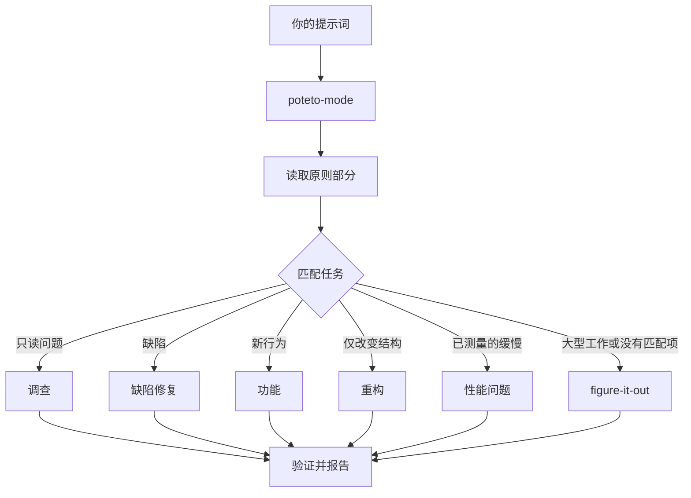

# 通过 `/poteto-mode` 分派工作

`/poteto-mode` 是入口。你给出目标，它匹配 23 个操作流程之一，把步骤复制到任务清单，并在需要时调用其他技能。本页介绍好的提示词是什么样，以及你实际需要写得多么少。


## 提示词会经历什么



图中是常见路径。还有围绕指标持续优化、诊断运行时症状和已捕获轨迹、原型、视觉一致性、编写与评估技能、自主执行、开 PR、将 PR 或堆叠推进到可合并、落地已验证堆叠、自动推进 PR 队列或堆叠、协调项目级计划、会话接续、安全暂停、多阶段计划和工作树清理等流程。完整集合在[操作流程目录](../../skills/poteto-mode/playbooks/)。

## 说目标，不说仪式

不需要写一份规格。说明哪里出错、想要什么，再加上已经知道且能节省代理时间的信息：

```text
/poteto-mode 用户重试后收到两次通知。先复现，再修复并验证。
```

这是缺陷修复提示词。“先复现”是真实约束，不是客套话，流程会遵守。你会看到任务清单填入缺陷修复步骤；跳过的步骤仍以 `skip: <reason>` 可见。

## 提示词里放什么

有用的提示词最多携带五项内容，每项都可以放进一句话：

- **目标。** 说明出了什么问题，或想要什么。
- **完成判据。** 必须能通过或失败。“做得更好”“做一个小时”都不是判据。
- **想看到的证据。** 真实命令输出、流程视频、存储值，或前后对比数字。
- **已知事实。** 症状、复现步骤、日志行或链接可以减少一次搜索。
- **真实约束。** “先复现”“暂时不改代码”“行为零变化”“继续前让我审查”都会改变代理行为。

下面一条提示词包含全部五项：

```text
/poteto-mode 昨天部署后，CSV 导出会丢掉最后一行。失败任务编号 4812。先复现，再修复。完成意味着 6 万行夹具每一行都导出。给我修改前后的行数。
```

有两项值得省略：

- **具体做法。** 说要实现什么，给代理寻找比你选定路线更好方法的空间。技能清单也是如此，下方常见问题会说明。
- **一开始就给原因猜想。** 说出猜想会将搜索范围限制在你指向的位置。先让代理复述问题，再分享直觉。

长讨论或模糊缺陷这类杂乱报告，应先要求复述：

```text
/poteto-mode 阅读这段讨论。用自己的话和通俗英语复述根本问题。暂时不改任何代码。
```

误读会在复述时、代码出现之前显露。在这里纠正只花一条消息，不是一次错误修复。只想复述而不走操作流程时，运行 [`/in-your-own-words`](../../skills/in-your-own-words/SKILL.md)。它说明代理理解的目标及你想解决的问题。

不确定提示词方向是否正确时，在发送前运行 [`/sharpen`](../../skills/sharpen/SKILL.md)：

```text
/sharpen 为 v2 配置格式写一份迁移指南。
```

代理会说明顶尖专业人士还会做哪些你没要求的工作、会从哪些最原始材料开始、采用什么方法和工具，以及什么外部证据能证明结果正确。随后将提示词改写成明确要求这些内容的版本，更深入而不扩大范围，同时保留你的选择。它不执行任务。读过改写后再发送，例如配合 `/poteto-mode`。

## 简短跟进

对话已经包含背景时，提示词可以缩短到几乎没有额外内容。以下都足够：

```text
/poteto-mode 做吧
```

```text
继续
```

```text
一直做完
```

简短也有效，因为操作流程保存结构，Custom Mode 让 `/poteto-mode` 每轮都留在上下文里。[配置 pstack](./01-setup.md#run-your-first-task) 说明怎样启动。你的话承载意图，技能承载严谨性。

## 用“new task”切换任务

长对话会积累上个任务的背景，切换主题时应明确说明：

```text
/poteto-mode new task。查清为什么退出登录后缓存条目还存在，暂时不改任何代码。
```

“new task”要求 `/poteto-mode` 重新匹配，而不是继续之前的流程。“暂时不改代码”将本次限定为调查。没有这两句，正在功能流程中的模式容易把问题当成下一项功能步骤。

## 给并行工作独立机器

多个代理在同一台电脑上针对同一仓库运行，会争用工作树、端口和构建输出。最彻底的隔离是[云子代理](https://cursor.com/docs/subagents#cloud-subagents)：每个都有独立 VM 和分支，可以安装依赖、运行应用、录制结果视频而不影响你的机器。在任务前输入 `/in-cloud`，或要求父对话将工作交给云子代理。

工作必须留在本地时，提前要求 worktree：

```text
/poteto-mode new task。从 <基线> 新建分支和 worktree，再在那里移植解析器改动。
```

每个任务有自己的分支和 worktree，就不会相互覆盖文件。工作树消耗磁盘和机器资源，所以笔记本一次只能运行少量。[开启 PR 流程](../../skills/poteto-mode/playbooks/opening-a-pr.md) 已经为代码变更使用 worktree，通常只有基线或位置有特别要求时才需说明。

工作树会积累。磁盘紧张时可以问：

```text
/poteto-mode 什么在占用磁盘？清理那些有证据可以安全清理的 worktree。
```

[工作树清理流程](../../skills/poteto-mode/playbooks/worktree-cleanup.md) 按合并状态、未提交工作及仍在使用它的对话分类。只删除证据允许的对象，包含未提交工作的对象会停下来等你决定。

## 让工作继续运行

离开时说清完成条件即可：

```text
/poteto-mode 我要离开一会儿。一直做，直到迁移检查显示旧调用者为零。记录你的决定。
```

之后才审查的工作会分派到 [`/figure-it-out`](../../skills/figure-it-out/SKILL.md)，由它设计阶段并保存 [`/show-me-your-work`](../../skills/show-me-your-work/SKILL.md) 决定日志。[睡觉时继续工作](./07-overnight.md) 介绍完整的夜间执行约定。

**常见问题：** 不要在提示词里枚举技能，例如“先 /how，再 /architect，再 /arena”。流程已经排好顺序，手工序列通常会重排或遗漏原本保留的步骤。只有想覆盖某个具体选择时才指定技能。

完整分派规则见 [`poteto-mode`](../../skills/poteto-mode/SKILL.md) 本身。

下一页：[理解代码](./03-understand.md)。
