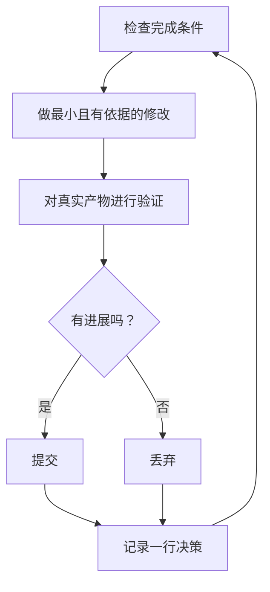

# 在睡觉时运行工作

前面所有内容的价值在这里体现。能够可信地验证自身工作的智能体，可以独自处理困难任务。安全的依据不是希望，而是可检查的完成条件、隔离的 worktree 或云智能体，以及供你早上审计的决策日志。


## 先建立信任，再启用循环

你不信任的循环，只会更快地产生未经检查的工作，而且混乱每轮累积。离开前，让它先证明值得信任：

- 你亲手做过一次任务，或看过智能体完成，所以知道什么样算好。
- 智能体拥有你自己会用的工具和信号，如验证技能、性能分析器、日志。
- 每个阶段都证明自己的工作；未达标准时，可以停止整条流程。
- 你读过几份对话记录，并把重复失败变成了工具、技能或检查。

四点全部成立后，才让循环自主运行。在此之前，边观察边运行。

## 夜间运行约定

好的交接包含目标、完成条件、权限和退出方式，不需要很长：

```text
/poteto-mode 我要睡了。在从 <base> 创建的新 worktree 中，把每个调用者迁移到新解析器。
完成意味着旧调用者为零、全部解析器夹具通过、旧 API 已删除。
保留决策日志。提交前不用问我。
/loop 直到完成。如果几个小时后确实卡住，就停止并写明原因。
```

逐行看看它们带来了什么：

- “我要睡了”是会话覆盖指令。智能体停止提问，继续推进。
- “完成意味着……”把目标变成每轮都能运行的检查。
- “从 `<base>` 创建的新 worktree”防止运行与其他已打开工作冲突。
- “提交前不用问我”预先回答了本来可能阻塞智能体的权限问题。
- `/loop` 是 Cursor 内置唤醒机制，不是 pstack 技能。[自主运行规程](../../skills/poteto-mode/playbooks/autonomous-run.md)用它在事件或心跳时重新检查完成条件。
- 退出方式允许它在真正走到死路时停下并说明原因，这比八小时里不断创造性重解释目标更好。

由于你离开后才会审查这些工作，`/poteto-mode` 会通过 [`/figure-it-out`](../../skills/figure-it-out/SKILL.md) 分流，在写代码前设计运行阶段并接上决策日志。

要主动停止运行，告诉智能体暂停，或说明你即将离线或重启 Cursor。[安全暂停规程](../../skills/poteto-mode/playbooks/pause-safely.md)会完成或撤回当前步骤，提交一个进行中的检查点，并写下恢复说明。新聊天通过 Session pickup 规程从该说明恢复工作。“继续”永远不会触发暂停。

## 循环整夜做什么



每轮一次修改、一次检查、一行日志。无帮助的修改会被丢弃，不留着混入结果。停滞意味着换方向，不意味着停止；完成条件不会悄悄放宽来宣称胜利。

## 早晨审计

[`/show-me-your-work`](../../skills/show-me-your-work/SKILL.md) 让运行可审查。每行记录时间、阶段、决策、原因、证据指针和结果，放在 `decisions.tsv` 中；多次运行共享目录时，放在 `.audit/<task-slug>.tsv`。默认保留在本地。工作规模大到审查者需要过程证据才能信任结果时，再提交日志。

回来后，要求按审查形式交代运行：

```text
/show-me-your-work 告诉我昨晚做了什么
```

技能给出总结前，会启动不同模型家族的审查者阅读过程记录和对话记录；回复最后包含 Attention 章节，列出值得你仔细检查的事项。先读该章节，再读它指向的日志行。你在审计决策，而不是重读整晚。

若只需快速状态，而非审计，在执行工作的聊天中运行 [`/ketchup`](../../skills/ketchup/SKILL.md)。它只读，用普通话说明从你上一条消息之后发生的变化，附上工作产生的截图和小图。然后列出每个等待你的决定，例如合并、批准或选择，并给出建议、证据和风险，使你仅凭回复即可决定。

## 夜间要处理的是队列，而非单个任务

上述约定让一个任务走向一个完成条件。有些夜晚任务更多，是独立变更队列或完整项目。三份规程扩大相同信任机制的适用范围。

[Autopilot-full](../../skills/poteto-mode/playbooks/autopilot-full.md) 将独立 PR 队列运行到合并。每个 PR 有一个负责智能体，从构建一路负责到合并，负责人不能只凭自己的判断合并。一组新验证者检查负责人的代码就绪版本。后续变基或小修只需一位新验证者；只有新行为或大量新差异才再次调用完整验证组。只有对实际合并补丁给出的干净结论才能授权合并：

```text
/poteto-mode 对这个队列全自动执行。每项都独立。我要它们早上之前合并。
```

[Autopilot-stack](../../skills/poteto-mode/playbooks/autopilot-stack.md) 是不执行合并的 Autopilot-full。醒来后，你会看到已验证 PR 和各自结论，再自行审查和落地。某个 PR 只叠在它实际依赖的 PR 上。若希望任何合并前都亲眼检查，就选它而非 Autopilot-full：

```text
/poteto-mode 自动处理这五项变更，但不要合并。我早上自己落地。
```

[Orchestrate](../../skills/poteto-mode/playbooks/orchestrate.md) 面向比任何单个智能体存活更久的项目：跨多天、很多堆叠 PR，以及由一个持续协调聊天管理的子智能体群。协调者决定谁做哪部分，检查各自产物，从不亲自写代码。如果一个智能体能在一次会话完成，规程会让你回到上述夜间运行约定：

```text
/poteto-mode 编排存储迁移。持续负责，直到每个包都迁移并合并。我每天查看两次。
```

## 并行运行多个项目

[Cursor Project](https://cursor.com/blog/projects) 为一个协调智能体提供持久线程。协调者不写代码，只指挥子智能体；子智能体默认在云端运行，因此关闭笔记本后工作仍继续。这是 Orchestrate 规程预期的结构。向协调者发提示时，以 `/poteto-mode` 开头；它创建的子智能体会遵循相应规程。

几个习惯有帮助：

- 每组工作建立独立 Project，例如功能、迁移、性能改进或技术债清理。多个项目可以并行。
- 把相关聊天拖入 Project，完成的也包括在内。它们会成为其中每个智能体的上下文。
- 每个 PR 合并前都安排验证组，用 Autopilot-stack 或 Autopilot-full 推进队列。
- 要求协调者拿出数据支持的计划，先用原型回答开放问题，再向你提问。

一个提示可以覆盖整个 Project，从研究到执行：

```text
/poteto-mode 重构这个仓库，让架构更适合智能体工作。对历史提交和审查评论使用 /correct 与 /architect，找出智能体最常犯的错误。用 /recall 获取历史聊天背景。用原型回答开放问题，不要先问我。拿出真实数据支持的计划。批准后，用 autopilot-stack 或 autopilot-full 执行，并问我选哪个。
```

## 让循环自行启动

上面的每种循环仍需要你启动。计划或事件驱动的自动化去掉了这一步。软件维护可以分为适合这样运行的阶段：分诊报告、复现、修复、验证修复。两条规则让这样的流程可信：

- 每个阶段都可以停止流程。分诊可判定报告属于预期行为，复现可能无法复现，修复者也可判断变更风险太高。这些结果都有价值，因为它们阻止坏工作进入撤销代价更高的下一阶段。
- 每个阶段都交付证据。复现附上损坏状态的截图与视频，修复附上前后对比证据。这样人类无需先读代码，就能判断智能体是否修对了问题。

pstack 将它作为面向 Slack 问题报告的休眠[自动化包](https://github.com/cursor/plugins/blob/2eaf46574b25cdf7ef8c849837099b866b7438ce/pstack/automations/benny/README.md)提供。一个自动化逐个分诊报告，另一个复现已确认 bug，并可能准备小型修复草稿。把它的 [`FOR_AGENTS.md`](https://github.com/cursor/plugins/blob/2eaf46574b25cdf7ef8c849837099b866b7438ce/pstack/automations/benny/FOR_AGENTS.md)交给智能体，并指定目标仓库，即可进行配置。

**易错点：**时长不是完成条件。“在这上面工作 4 小时”没有可检查的目标，醒来后你只会看到四小时活动，而非结果。给 `/loop` 一个可以判定通过或失败的条件。

下一步：[用原则名称引导工作](./08-principles.md)。
